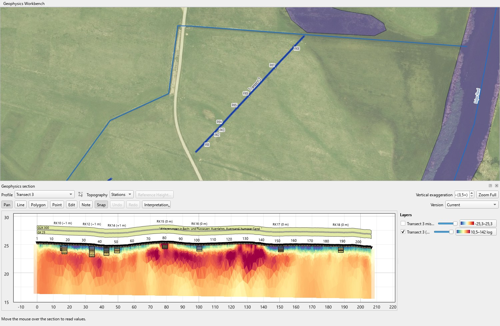
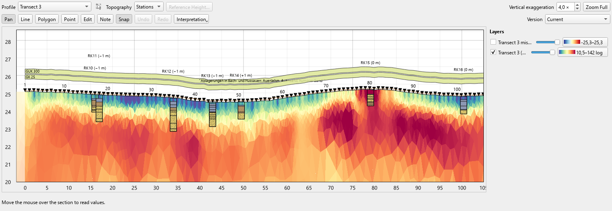
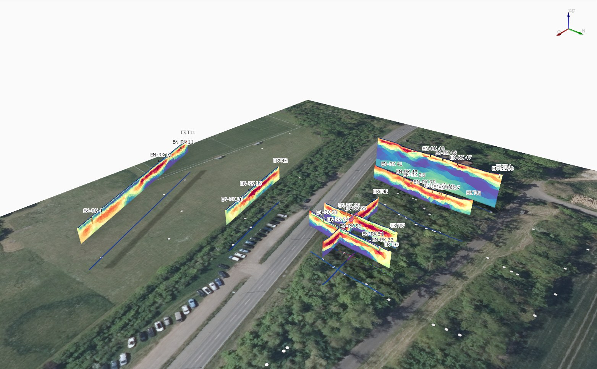
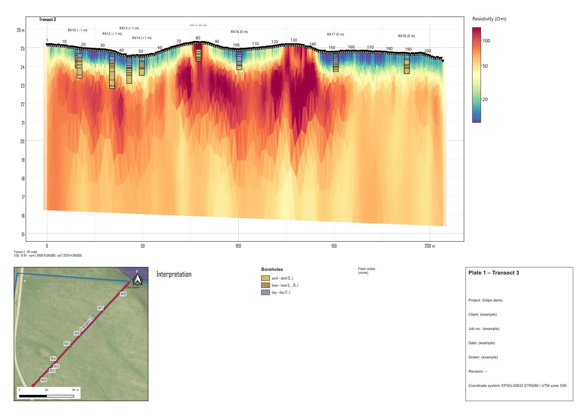

# Groundwork

*Geophysical profiles in QGIS.* Formerly “Geophysics Workbench”.

**See your geophysical profiles where they are: on the map, next to the boreholes and the
geology.** Groundwork is a plugin for profile-based geophysics in QGIS: sections as a
panel under the map, with your boreholes, geology and crossing lines on them, your
interpretation as ordinary QGIS layers, report plates in the QGIS layout, and all of it
standing in QGIS's 3D view.

Today it works with **resistivity (ERT)** and **seismic refraction** (P-wave velocity
models). **Ground-penetrating radar (GPR) and seismic reflection sections** are planned next,
on the same profiles, next to the same context.

*Lake Gülpe, Brandenburg: a resistivity profile on the map (top) and as a section under it,
with sediment cores and two geology maps drawn as strips above the ground. Real open data,
included as a demo.*

## What it does

| | |
|---|---|
| 🗺️ **Map and section, linked** | A section panel under the map. Move the mouse over the section and a cursor follows on the map, and the other way round. |
| 📥 **Your files as they are** | ERT models from R2/ResIPy, ZondRes2D, pyGIMLi/BERT and VTK, plus measured data and misfit; seismic refraction velocity models from Refrapy and pyGIMLi, faded where no ray reached. Any other text table works too: say which column is what, as in QGIS's own text import. Files are read where they lie and never changed. |
| 📍 **On the real electrodes** | Models are placed on the surveyed electrode positions, even when only some were measured, with a report of how well they fit. Sections in local heights get a reference height. |
| 🪨 **Context on the section** | Boreholes as lithology columns with log curves, one or more geology (or soil, land use) maps as strips above the ground, a terrain line from a DEM, crossing lines and ties to crossing profiles. All styled through QGIS. |
| ✏️ **Interpretation as QGIS layers** | Draw lines, polygons and points on the section per profile, with type, name, confidence and note. Undo, frozen versions, 2D and 3D layers, DXF and CSV export. |
| 📄 **Report plates** | A4 and A3 layouts with stacked sections, colour bars, legends, a mini-map and a title block, exported as vector PDF. Your text edits survive updates. |
| 🧊 **3D view** | Models as curtains under their profiles (cells, point clouds or the section as a picture), boreholes as columns with their names, stations and the interpretation at its depth, in QGIS's own 3D view. Point at a curtain and the section shows the place; cut the view open along a profile. Shown when you ask, kept out of your Groundwork file. |

*Erfurt in QGIS's 3D view: seven resistivity profiles as curtains, with the cores as
columns. Aerial image: © GDI-Th, dl-de/by-2-0.*

## Get started

1. **Install** QGIS 4.2 or newer.
2. **Download** `groundwork_geophysics-0.14.1.zip` from the
   [latest release](https://github.com/SebBenJamin/groundwork-qgis/releases/latest).
3. In QGIS choose **Plugins → Manage and Install Plugins… → Install from ZIP**, pick the zip
   and click **Install Plugin**. A **Groundwork** menu appears.
   (German QGIS: **Erweiterungen → Erweiterungen verwalten und installieren… → Aus ZIP
   installieren**.)
4. **Try a demo:** download a demo zip from the same release, unzip it into a folder of its
   own and open its project. Then choose **Groundwork → Show Section Panel** and
   pick a profile.

| Demo | Data | Open |
|---|---|---|
| Gülpe | Real: ERT, sediment cores and state survey data from Lake Gülpe (Havel, Brandenburg) | `guelpe_project.qgz` |
| Erfurt | Real: seven ERT lines and 56 cores from Erfurt (Thuringia) | `erfurt_project.qgz` |
| Calhoun | Real: four crossing seismic refraction lines (Vp) from the Calhoun Critical Zone Observatory (South Carolina, USA) | `calhoun_project.qgz` |
| Synthetic | Made up: three ERT formats, boreholes and geology | `demo_project.qgz` |

The background maps and the Gülpe state layers load from the internet. Opening a demo writes
to its Groundwork file; keep a copy of the folder if you want to start over.

  

<em>A report plate made from the Gülpe demo, straight from the QGIS layout.</em>

## Where it is going

Groundwork is built around the profile, not around one method. A profile is a line on the
map with its surveyed positions; any data measured along it can be placed on it and shown
with the same boreholes, geology and interpretation. Planned:

- 📡 **GPR**: radargrams on the profile.
- 🔊 **Seismic reflection**: processed (zero-offset) seismic sections on the profile.
- 🔀 **Several methods on one profile**: ERT, GPR and seismics side by side, interpreted
  together.

Ideas and wishes are welcome as [GitHub issues](https://github.com/SebBenJamin/groundwork-qgis/issues).

## Documentation

The documentation is on its own site, with search:
**https://sebbenjamin.github.io/groundwork-qgis/**

The same pages, in the repository:
- How-tos: [Add data](docs/user/howto/add-data.md) ·
  [Placement on the electrodes](docs/user/howto/placement.md) ·
  [Reference height](docs/user/howto/reference-height.md) ·
  [Boreholes and logs](docs/user/howto/boreholes.md) ·
  [Field notes](docs/user/howto/field-notes.md) · [Dataset info](docs/user/howto/dataset-info.md) ·
  [Report plates](docs/user/howto/plates.md) · [The 3D view](docs/user/howto/3d-view.md)
- Data formats: [Borehole tables](docs/user/formats/borehole-tables.md) ·
  [Plate templates](docs/user/formats/plate-templates.md)
- [Troubleshooting](docs/user/troubleshooting.md)
- [What changed in each release](docs/releases/), latest: [0.14.1](docs/releases/0.14.1.md)

Your work is kept in one GeoPackage next to the QGIS project (`<project>_groundwork.gpkg`).

## Status and feedback

The plugin is **experimental**: it works on the demos and on real projects, but it is young
and things still change between versions. Please report problems and wishes as
[GitHub issues](https://github.com/SebBenJamin/groundwork-qgis/issues): what you did,
what you expected, what happened, and a screenshot if it helps.

If Groundwork saves you time, you can buy me a coffee:

## For developers

- **Tests** run in QGIS's own Python, offscreen: `scripts/test.ps1` (whole suite) or
  `scripts/test.ps1 tests/test_package.py -q`. pytest is not bundled with QGIS; install it
  once into `.testlibs`:
  `$env:PYTHONNOUSERSITE=1; & "<QGIS folder>\bin\python-qgis.bat" -m pip install --target .testlibs pytest`.
- **Release zips** (`dist/`): `& "<QGIS folder>\bin\python-qgis.bat" scripts/package.py`.
- **README pictures** (`docs/images/`): `scripts/render_readme_images.py`, from the Gülpe demo
  (needs the internet for the live layers).
- **Working copy in QGIS**: `scripts/dev_install.ps1` links `groundwork_geophysics/` into the
  plugin folder of your QGIS 4 default profile.
- The scripts expect QGIS 4.2.3 in its default install folder (`C:\Program Files\QGIS 4.2.3`).

## Data sources and licences

The plugin's code is licensed under **GPL-2.0-or-later** (see `LICENSE`). The demo data is
open data from the sources below; each demo folder also has an `ATTRIBUTION.md` with the
details.

**Gülpe demo** (`demo_guelpe/`)
- ERT: Pohle, M.; Birnstengel, S.; Werban, U. (2025): 2D-ERT data measured in June 2023 and
  June 2024 in the Lower Havel Inner Delta near Lake Gülpe, Brandenburg (Germany). PANGAEA,
  https://doi.org/10.1594/PANGAEA.983478. CC BY 4.0.
- Cores: Köhler, A.; Kaniecki, M.; Schneider, B.; Zielhofer, C. (2025): Field based and
  laboratory data of sediment cores from the Lower Havel Inner Delta near Lake Gülpe. PANGAEA,
  https://doi.org/10.1594/PANGAEA.983887. CC BY 4.0.
- Both belong to: Köhler, A. et al. (2025): Geophysical, Sedimentological and Geochemical Data
  from the Lower Havel Inner Delta (Gülpe Island), Brandenburg (Germany). PANGAEA,
  https://doi.org/10.1594/PANGAEA.983208; data paper: Data in Brief 112372,
  https://doi.org/10.1016/j.dib.2025.112372.
- Boreholes (Bohrpunktkarte) and geology (Geologische Karte 1 : 25 000, and the GÜK300
  switched off on the map; both drawn as strips on the section), live WFS: © LBGR,
  dl-de/by-2-0.
- DGM1 terrain model (tiles merged and cropped) and DOP20 aerial images (live WMS):
  © GeoBasis-DE/LGB, dl-de/by-2-0.
- Waterways: © OpenStreetMap contributors, ODbL.

**Erfurt demo** (`demo_erfurt/`)
- ERT: Silbermann, M.; Pohle, M.; Jung, P.; Werban, U. (2025): 2D-ERT data for localizing a
  Black Death mass grave in Erfurt, Thuringia (Germany). PANGAEA,
  https://doi.org/10.1594/PANGAEA.974818. CC BY 4.0.
- Cores: Hein, M. et al. (2026): What the landscape can tell: An integrative stratigraphic
  prospection approach to localize a Black Death mass grave in Erfurt/Central Germany.
  PLoS ONE 21(1): e0337410, https://doi.org/10.1371/journal.pone.0337410, Supporting
  Information S1 File, Suppl. Table 3. CC BY 4.0.

**Calhoun demo** (`demo_calhoun/`)
- Seismic refraction picks and line positions: Flinchum, B. A.: Supporting Data Repository:
  Landscape Curvature and Deep Critical Zone Structure. HydroShare,
  http://www.hydroshare.org/resource/340773feb3b341d884f6742b55966609. CC BY 4.0. The Vp
  models are re-inverted from these picks with pyGIMLi (as Refrapy's Refrainv runs it),
  not the authors' published models.
- Terrain: USGS 3D Elevation Program 1 m DEM (cut to the lines), public domain.

**Synthetic demo** (`demo/`)
- Power line and pylons: © OpenStreetMap contributors, ODbL. Everything else (boreholes,
  geology, terrain, ERT models) is made up for the demo and does not describe the real ground.

**All demos:** background map © OpenStreetMap contributors, ODbL,
https://www.openstreetmap.org/copyright.

**README pictures** (`docs/images/`): made from the Gülpe demo with the sources above;
aerial images © GeoBasis-DE/LGB, dl-de/by-2-0.

Licences: CC BY 4.0, https://creativecommons.org/licenses/by/4.0/ ·
Datenlizenz Deutschland Namensnennung 2.0 (dl-de/by-2-0), https://www.govdata.de/dl-de/by-2-0 ·
ODbL, https://opendatacommons.org/licenses/odbl/
