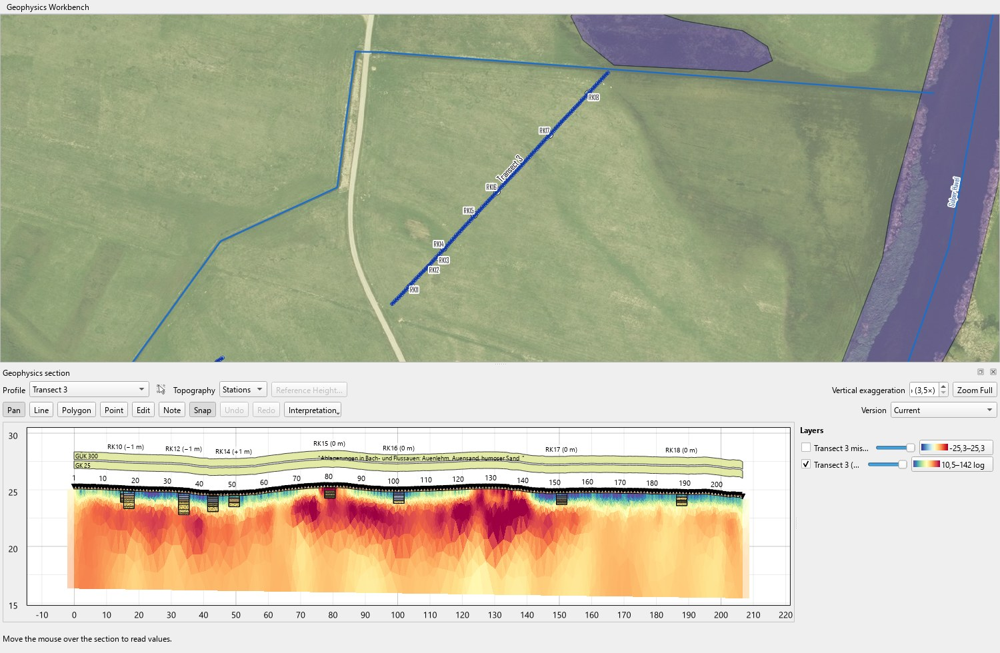

# Groundwork

*Geophysical profiles in QGIS.*

Groundwork shows your geophysical profiles where they are: on the map, next to the boreholes
and the geology. Sections open as a panel under the map, with your boreholes, geology and
crossing lines on them; your interpretation is kept as ordinary QGIS layers, and report plates
come from the QGIS layout. Today it works with resistivity (ERT); ground-penetrating radar and
seismics are planned.

## Get started

1. **Install** QGIS 4.2 or newer.
2. **Download** `groundwork_geophysics-<version>.zip` from the
   [latest release](https://github.com/SebBenJamin/groundwork-qgis/releases/latest).
3. In QGIS choose **Plugins → Manage and Install Plugins… → Install from ZIP**, pick the zip
   and click **Install Plugin**. A **Groundwork** menu appears.
   (German QGIS: **Erweiterungen → Erweiterungen verwalten und installieren… → Aus ZIP
   installieren**.)
4. **Try a demo:** download a demo zip from the same release, unzip it into a folder of its
   own and open its project. Then choose **Groundwork → Show Section Panel** and pick a
   profile.

| Demo | Data | Open |
|---|---|---|
| Gülpe | Real: ERT, sediment cores and state survey data from Lake Gülpe (Havel, Brandenburg) | `guelpe_project.qgz` |
| Erfurt | Real: seven ERT lines and 56 cores from Erfurt (Thuringia) | `erfurt_project.qgz` |
| Synthetic | Made up: three ERT formats, boreholes and geology | `demo_project.qgz` |

The background maps and the Gülpe state layers load from the internet. Opening a demo writes
to its Groundwork file; keep a copy of the folder if you want to start over.

Your work is kept in one GeoPackage next to the QGIS project (`<project>_groundwork.gpkg`).
**Groundwork → About Groundwork…** shows which version you have.

## Where to go next

- **How-tos**: one task each, from [adding data](user/howto/add-data.md) to
  [report plates](user/howto/plates.md).
- **Data formats**: [which methods and files](user/formats/overview.md) the plugin reads and
  writes, what [borehole tables](user/formats/borehole-tables.md) and
  [plate templates](user/formats/plate-templates.md) must look like.
- **[Troubleshooting](user/troubleshooting.md)**: when something doesn't show.
- **[What's new](releases/index.md)**: the changes in each release.

Problems and wishes are welcome as
[GitHub issues](https://github.com/SebBenJamin/groundwork-qgis/issues).
