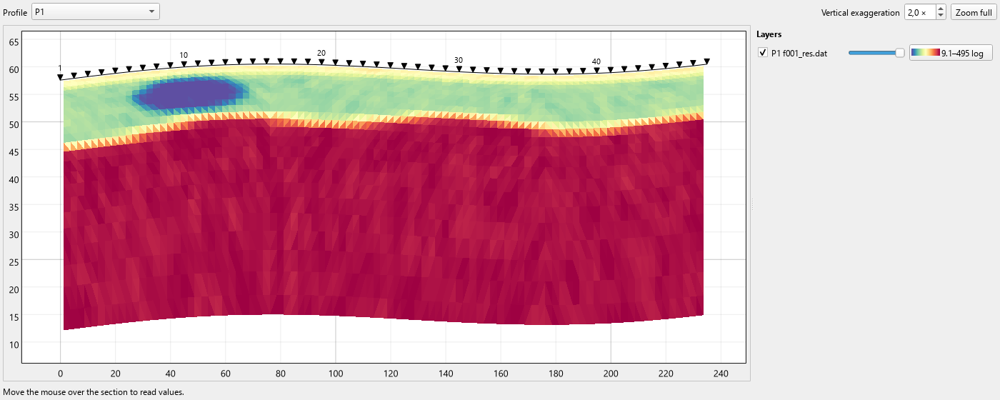
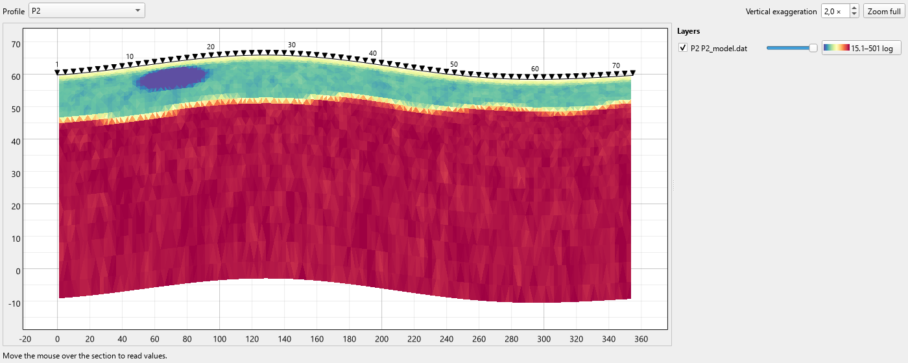

# Geophysics Workbench 0.1.0: profiles and ERT model sections

First test release. It puts your ERT inversion results where they belong: on their
profile line on the QGIS map, with the section drawn under the map and linked to it.

## What's new

- **Profiles on the map.** Create a profile from an electrode table (CSV/text), from a
  line you select on the map, or from a start and end point. Each profile keeps its
  electrodes (stations) and their elevations.
- **ERT model sections under the map.** R2/ResIPy `f001_res.dat`, ZondRes2D XYZ text and
  legacy VTK models are drawn as coloured sections that follow the topography. Depth
  models are hung from the electrode elevations.
- **Map and section are linked.** Hover over the section and a red marker follows on the
  map; move along a profile on the map and a dashed line follows in the section.
- **Layers per profile.** Show/hide, opacity and colour scale (colour map, range, log) for
  each model, plus vertical exaggeration.
- **Everything in one project file.** Profiles, stations and the list of models are kept in
  a GeoPackage next to your QGIS project. The model files stay where they are.

## Install

You need QGIS 4.2 or newer.

1. In QGIS: **Plugins → Manage and Install Plugins… → Install from ZIP**
   (German QGIS: **Erweiterungen → Erweiterungen verwalten und installieren… → Aus ZIP
   installieren**).
2. Choose `geophysics_workbench-0.1.0.zip` and click **Install Plugin** (German:
   **Erweiterung installieren**). If QGIS warns about plugins from untrusted sources,
   confirm.
3. A new menu **Geophysics Workbench** appears in the menu bar.

To get the demo, unzip `geophysics_workbench-demo-0.1.0.zip` into any folder. Keep the
files together: the project finds its data next to it.

## What to try

1. **Open the demo.** **Project → Open…** (German: **Projekt → Öffnen…**) and choose
   `demo_project.qgz` in the unzipped folder. You see three profiles (P1, P2, P3) beside a
   real powerline on an OpenStreetMap background (needs internet).
2. **Pick P1 on the map.** **Geophysics Workbench → Pick profile on map**, then click on
   the P1 line. The section panel opens under the map. You can also use **Geophysics
   Workbench → Show section panel** and choose a profile in the **Profile** list.
3. **Hover over the lens.** Move the mouse over the blue (conductive) lens on P1. The line
   below the section shows distance, elevation, depth, X/Y and the resistivity, and the red
   marker on the map shows where you are. With the pick tool still active, move the mouse
   along the profile on the map and watch the dashed line in the section.
4. **Toggle and restyle layers.** In **Layers** on the right, untick a model to hide it,
   drag the slider for opacity, or click the colour bar to choose another colour map, range
   or log scale (**Auto** fits the range to the data).
5. **Change the vertical exaggeration.** Type or step a value (1–20 ×) next to
   **Vertical exaggeration**. **Zoom full** shows the whole section again. Drag to pan.
6. **Create a profile from a CSV.** **Geophysics Workbench → New profile…**, and in the
   **From station file** tab click **Browse…** and pick `data/stations/P4_electrodes.csv`
   from the demo folder (a fourth line, not yet in the demo project). The name becomes P4.
   Check that the columns are assigned (Electrode number, X, Y, Z), then **OK**. P4 appears
   on the map, crossing P1 and P2, and opens in the section panel with its topography and
   electrodes; it has no model yet. The other tabs make a profile from a selected line
   feature or from start/end points (**Pick on map**); tick **Number stations from the
   end** when electrode 1 was at the far end of the line.
7. **Add a model file.** Open a profile in the section panel (the menu item is greyed out
   until you do), then **Geophysics Workbench → Add ERT model…**. **Browse…** to the file. The format is usually recognised. Set **Z
   means** to *Elevation* or *Depth below surface*, and **Chainage offset** if the model's
   x does not start at the first electrode. The preview tells you what was read; **OK** adds
   it. In the demo, open P2 and add `data/ert/P2/P2_model_it2.dat` (Z means *Depth below
   surface*). It is a second inversion with a sharper lens; untick one layer or the other
   to compare them.
   For your own survey, start with **Geophysics Workbench → New workbench project…**
   (choose where to save the `.gpkg` and a projected CRS in metres), then New profile and
   Add ERT model.

Tip: QGIS's own elevation profile tool (**View → New Elevation Profile**) also draws the
section when its profile line runs along a workbench profile.

## Known limits

- Nothing is projected onto the sections yet (powerline, boreholes, other context data),
  and there are no interpretation tools. That comes in the next releases (M2, M3).
- ERT models only, and profiles need a projected CRS in metres.
- Colour scale, opacity and visibility changes are not saved yet; they reset when you
  reopen the project.
- Model files are read from where they are. If you move them, the section panel shows
  them in red as "source missing". Keep them inside the project folder so the project can
  be moved as a whole.
- Tested on Windows with QGIS 4.2.3.

Please send feedback on what you tried, what was unclear and what you missed.
