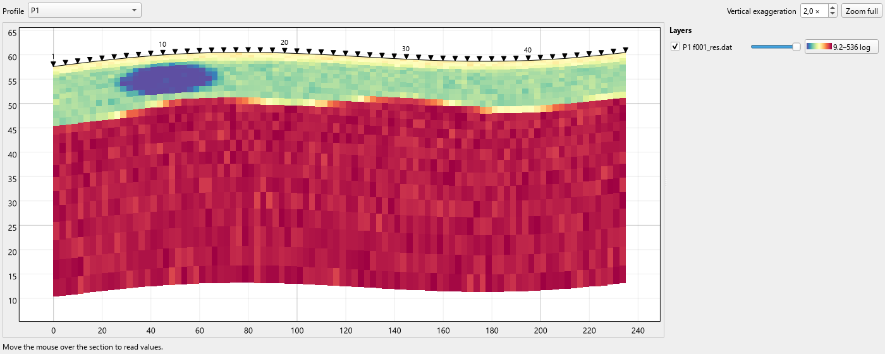
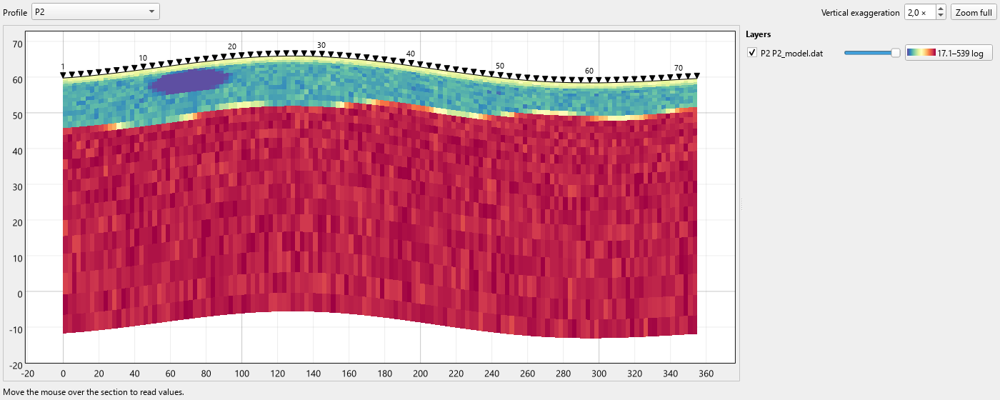

# Geophysics Workbench 0.1.1: model geometry fixes

This patch fixes the two geometry problems you found when testing 0.1.0.

## What's fixed

- **Models are no longer half a cell short (F3).** ZondRes2D XYZ files and R2/ResIPy
  `f001_res.dat` files store one value per cell, at the cell's centre. 0.1.0 drew the model
  only between those centres, so it started at 1.25 m instead of 0 m and sat below the
  surface. Now the real cells are drawn: P2's model starts at station 1 (0 m), ends at
  355 m, and its top lies on the surface. At the bottom the missing half layer is back too.
  The colour range shifts a little, because each cell now shows its own value.
- **A model longer than the profile's stations is no longer accepted silently (F1).**
  - When you add a model whose ends lie more than two electrode spacings outside the
    stations, **Add ERT model** shows an orange warning, for example: "Model spans
    0–355 m along the profile; P4's stations span 0–235 m (120 m beyond the last
    station). Is this the right profile?" When you click **OK**, it asks once more.
    **No** (the default) adds nothing.
  - In the section, the part of a model outside the stations is drawn pale, and the line
    under the section ends with "beyond stations" when the mouse is there. The model is
    still shown, because real models may reach a little past the outer electrodes.
    Beyond the last station a depth model hangs from the last station's elevation, so do
    not read its depths there.

## How to update

1. **Plugins → Manage and Install Plugins… → Install from ZIP** (German QGIS:
   **Erweiterungen → Erweiterungen verwalten und installieren… → Aus ZIP installieren**).
2. Choose `geophysics_workbench-0.1.1.zip` and click **Install Plugin** (German:
   **Erweiterung installieren**). It replaces 0.1.0.
3. Restart QGIS.

Your projects and the demo stay as they are. The demo data has not changed; you can keep
using the demo folder you already have.

## What to check

1. **P2 at 0 m.** Open the demo, then show P2 in the section panel (**Geophysics
   Workbench → Pick profile on map**, then click the P2 line). Scroll the mouse wheel over
   the left end of the section to zoom in. The model starts exactly below station 1 (the
   triangle labelled 1, at 0 m), and its top touches the black surface line.
2. **P2's model on P4.** Open your P4 (or make it as in step 6 of the 0.1.0 note). If you
   already added `P2_model_it2.dat` to P4 in your 0.1.0 test, the part after 235 m is now
   pale. Move the mouse there: the line under the section ends with "beyond stations".
3. **The warning.** With P4 open, choose **Geophysics Workbench → Add ERT model…** and pick
   `data/ert/P2/P2_model_it2.dat` again. The orange warning appears below the preview.
   Click **OK**: QGIS asks "Is this the right profile?". Click **No**, then **Cancel**, so
   P4 does not get the model twice.

## Known limits

- Models whose cell centres do not line up in rows or columns (R2/ResIPy triangle meshes)
  are still drawn between the centres, as in 0.1.0. For exact cells, load ResIPy's `.vtk`
  output instead.
- On P1 (an R2 model that follows the topography) each cell has a flat top, so the top
  edge steps up and down the slope around the surface line (by up to about 9 cm in the
  demo).
- On very steep ground (roughly 35° or more, with thin top cells), a terrain-following
  R2 model is also drawn between the centres. The plugin does this on purpose rather than
  risk drawing cells with gaps between them.
- Everything else in the 0.1.0 note still applies.
