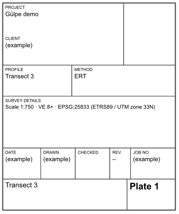

# Groundwork 0.11.0: a title block for plates, and documentation

## A title block like on an engineering drawing

New plates carry a **title block (stamp) ruled into cells**: project and client, a logo,
profile, method, survey details, date, drawn, checked, revision, job number, and the plate's
title and number. Each cell has a small caption and its value.

- **What you type once per project**, in **Plates… → Plate Details…**: project, client, job
  number, date, drawn, revision, and two new fields:
  - **Checked**, for who checked the plate;
  - **Logo**: choose an image file, or **Clear** it. A logo inside the project's folder is
    stored relative to it, so the folder can move. A logo that can't be found leaves its
    cell empty.
- **What the plate fills in itself:**
  - the profiles;
  - the method;
  - the survey details: acquisition date, electrode spacing, inversion software, reference
    and RMS from each model's **Dataset info**, plus scale, vertical exaggeration and the
    coordinate system;
  - the plate's title and number.

  Only what is known is printed. When the sections of one plate differ (two profiles at
  different scales, say), the stamp says "per section", and the line under each section
  has the details.

- **Every part is an ordinary QGIS layout item.** Restyle, move or delete it in the layout
  designer. Your text edits survive **Create / Update Plates**, and a cell you deleted stays
  deleted.
- **On A4**, the stamp takes room from the legends and the field notes, so it stays readable.
  The section area doesn't change.
- **The stamp uses the template's font.**

**Plates made before 0.11 keep their old title block** (a list of "Label: value" lines) and
keep updating it. To give an old plate the stamp, delete its layout in QGIS's Layout Manager
and press **Create / Update Plates**. The plate is made again from its template, so edits
made in the layout designer are lost.

## Documentation, Help and About

- **The documentation now has its own site, with search:**
  https://sebbenjamin.github.io/groundwork-qgis/
  It has how-tos, data formats, troubleshooting and these release notes. The guides you knew
  are split into short pages.
- **Help** in the Groundwork menu opens the site.
- **About Groundwork…** shows which version you have, the QGIS version, and links to the
  documentation, what's new, problem reports, the source code and the licence.
- **Help buttons** in Add Data, New Profile, Profile Properties, Context Layers, Plates and
  Plate details open the page for that dialog.

Help needs the internet. It opens the page in your browser.

## Updating

Install `groundwork_geophysics-0.11.0.zip` with **Plugins → Manage and Install Plugins →
Install from ZIP**, over 0.10. Your projects, Groundwork files and plates keep working.
