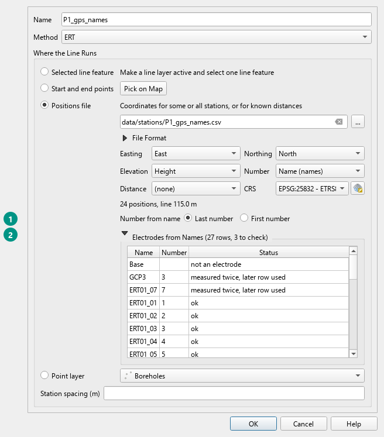

# Groundwork 0.12.0: electrode numbers from point names

## Field GPS files as they come

GPS files and point layers from the field usually **name** their points (`ERT03_15`, `E15`,
`T1_15`, `15a`, `Base`, `GCP3`) instead of numbering them. Until now the **Number** in
"Where the Line Runs" only took a column of numbers, so such a file had to be cleaned first.

Now the **Number** also lists the file's text columns, marked **(names)**, and a point
layer's text fields. Choose one and Groundwork reads the electrode number from each name:

- **Number from name**: the **last number** in the name (default, `ERT03_15` → 15) or the
  **first number** (`15_2` → 15).
- **Electrodes from Names** (folded up at first) lists every point as read, the ones to
  check first:
  - *not an electrode*: the name holds no number (`Base`);
  - *measured twice, later row used*: two points read as the same number. The later row in
    the file counts, the earlier one doesn't. A control point such as `GCP3` shows up here
    next to electrode 3.
- **Type another number** in a row to correct it, or **clear it** for a point that is not an
  electrode. The title says how many rows are left to check.



It works the same in **New Profile**, **Add Data** and **Profile Properties → Set surveyed
positions**.

**Your file is never changed, and your corrections are not kept.** Read the file again (for
example after cleaning it) and Groundwork starts from its own reading once more.

## Names stay with the stations

- The **fit report** names a station by its point name: *largest shift 1.6 m at station
  ERT03_16*.
- The stations' **attribute table** and **Identify** show a new **name** field.
- In a **new** project the stations layer's labels (off by default) show the name, or the
  number where there is none. Existing projects keep their label style.

## Updating

Install `groundwork_geophysics-0.12.0.zip` with **Plugins → Manage and Install Plugins →
Install from ZIP**, over 0.11.

**A Groundwork file opened in 0.12 is updated once** (the stations get the name field).
**0.11 cannot open it afterwards**, so update everyone who shares the project.

## What to try

1. Make a CSV like this, in your project's coordinate system:

   ```
   Punkt,Rechtswert,Hochwert,Hoehe
   Base,500005,5600020,60.0
   GCP3,500012,5600018,60.5
   ERT03_01,500000,5600000,57.0
   ERT03_02,500002,5600000,57.1
   ERT03_03,500004,5600000,57.2
   ERT03_04,500006,5600000,57.3
   ERT03_04,500006.1,5600000.1,57.3
   ERT03_05,500008,5600000,57.4
   ```

2. **New Profile** → **Positions file** → choose it. **Number** shows **Punkt (names)**.
3. Open **Electrodes from Names (8 rows, 3 to check)**: Base, GCP3 and the first ERT03_04 are
   on top.
4. Clear GCP3's number, and the title says *2 to check*. Type 9 for Base and see it become
   *corrected*.
5. Switch to **First number**: every ERT03 point reads 3, and the list shows the clash.
6. Choose the file again: your corrections are gone.
