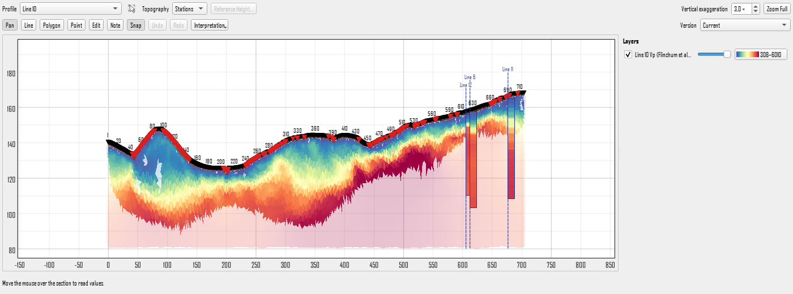

# Groundwork 0.13.0: seismic refraction

## Refraction velocity models on the profile

Groundwork now shows **seismic refraction** next to resistivity: P-wave velocity models on
the same profiles, with the same boreholes, geology and crossing lines.

- **Refrapy:** choose a Refrainv `_xzv.txt` in **Add Data**. It comes in as a P-wave velocity
  model in m/s. The shot and geophone points come from the `_topography.txt` saved next to it.
- **pyGIMLi and Refrapy `.vtk` files** now show the velocity, not the coverage.
- **Any other text table:** choose **P-wave velocity (m/s)** as the value. A new, optional
  **Coverage** column takes the inversion's coverage or sensitivity per cell.
- **Fade below the rays:** in the layer's colour scale, tick **Fade where coverage is low**.
  For a Refrapy file the threshold starts at Refrainv's own cut between resolved and
  unresolved cells. Cells no ray reached count as the lowest coverage, so they fade too.

## Each dataset knows its method

- The **Method** row in Add Data is shown for every file: **ERT** or **Seismic refraction**.
  It is preselected from the file, and measured ERT data are always ERT.
- The method gives each dataset its **type**, for example *ERT model* or *Seismic refraction
  Vp model*. The section's provenance line, the layer tooltip and the plate's title block show
  it, and the colour bar is titled *P-wave velocity*.
- A refraction profile has **geophones**: the title block says *Geophone spacing*, and
  **New Profile** offers Seismic refraction as the method.

## A new demo: Calhoun

`groundwork_geophysics-demo-calhoun-0.13.0.zip`: **four crossing refraction lines** (6, 10,
11 and 12) from the Calhoun Critical Zone Observatory, South Carolina, USA. The picks are open
data (Flinchum, HydroShare, CC BY 4.0). The lines lie on the USGS 1 m elevation model, with a
hillshade, OpenStreetMap and a plate of Line 10. The models were re-inverted from the picks
with pyGIMLi, as Refrapy's Refrainv runs it. `ATTRIBUTION.md` in the demo says how.

## Also changed

- **ERT files with `-inf` coverage** (cells no ray or current reached) now fade with the low
  coverage instead of being drawn in full.
- **One unresolved cell** no longer punches a hole in the fade.
- The Add Data summary writes resistivity as **Ω·m**.

## Updating

Install `groundwork_geophysics-0.13.0.zip` with **Plugins → Manage and Install Plugins →
Install from ZIP**, over 0.12. Your Groundwork files are not changed by this update.

## What to try

1. Unzip the Calhoun demo and open `calhoun_project.qgz`.
2. Open **Line 10** in the section panel. The crossing lines 6, 11 and 12 are drawn where
   they meet it. Hover over the layer to see its type, *Seismic refraction Vp model*.
3. Open the layer's colour scale and tick **Fade where coverage is low**: the part below the
   rays fades. Change the threshold and the fade follows.
4. Open the plate of Line 10: the title block says *Seismic refraction* and *Geophone spacing
   2 m*, and the colour bar *P-wave velocity*.
5. In your own Refrapy project, choose a `<line>_xzv.txt` in **Add Data**: the Method row
   proposes Seismic refraction.
