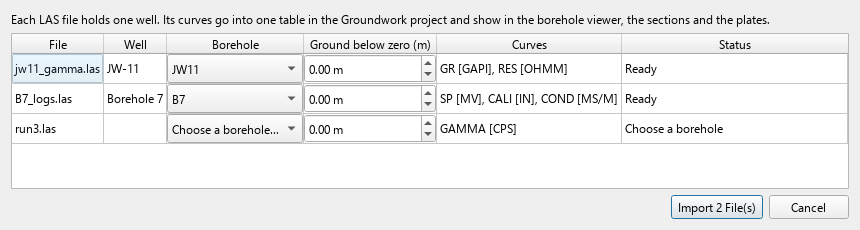
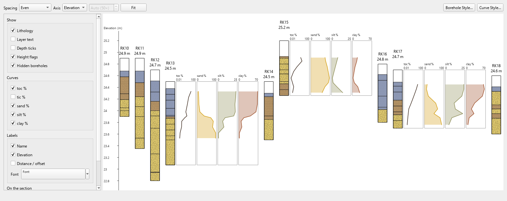

# Groundwork 0.16.0: nothing waits for the reading, and well logs from LAS

QGIS stays usable while models are read and the 3D view is prepared, and well logs come in
from LAS files.

## Reading in the background

- Opening a profile no longer freezes QGIS: its models are read in the background, and the
  section appears when they are in. You can switch profile or cancel meanwhile.
- What was read once is remembered beside the project, so the next opening is immediate.
- A strip from a web layer (a geology map served live) is fetched once and remembered.
  **Refresh Web Layers** in the profile list's menu fetches it again.

See [Projects and profiles](../user/howto/projects-and-profiles.md).

## The 3D view

- **Show in 3D…** prepares everything in the background, also the section pictures.
- With no 3D map view open, the **3D** button opens the view you had, as you left it,
  instead of a new one.

## Well logs from LAS files

- **Import LAS…** in a borehole entry of **Context Layers…** takes all your LAS files at once
  and matches each to its borehole. See
  [Logs from LAS files](../user/howto/boreholes.md#logs-from-las-files).
- Log curves are easier to read: each has its own colour, scales end on round numbers, and
  a borehole shows only the curves it has.

## Demos

- **Gülpe:** the cores show their measured lab values as curves, and Transect 4 lies the
  right way round.

## Fixes

- Opening a project with a saved 3D map view could crash QGIS.
- Section pictures could go missing from the 3D view until QGIS was restarted.

## Updating

Install `groundwork_geophysics-0.16.0.zip` (Plugins → Manage and Install Plugins… → Install
from ZIP). Projects need no update. The Gülpe demo is new; the other demos are unchanged.
