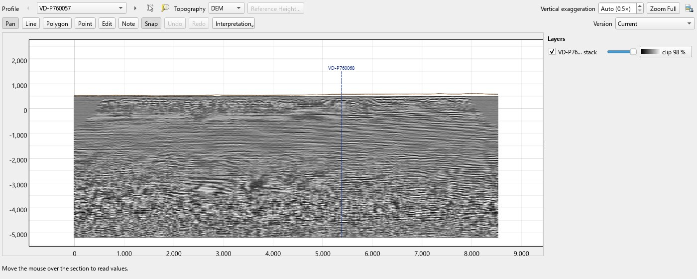
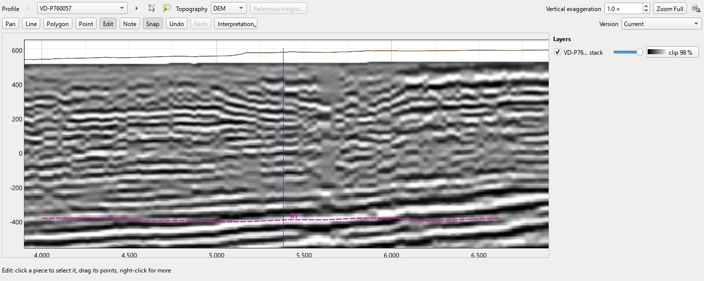
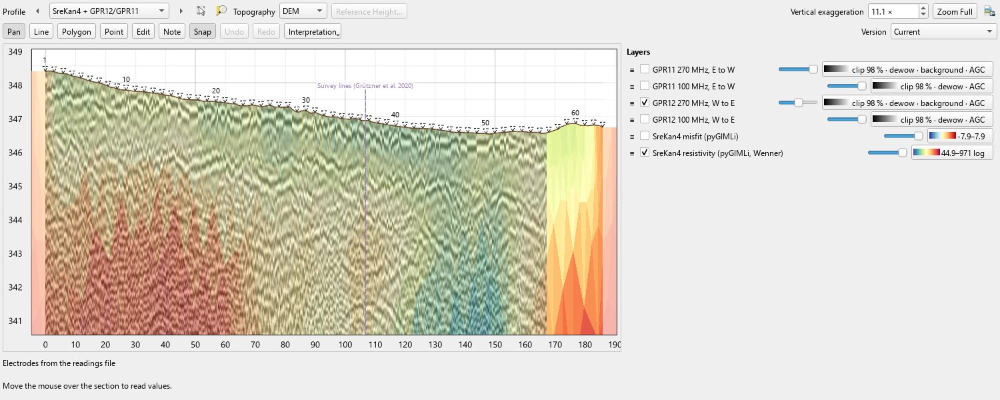
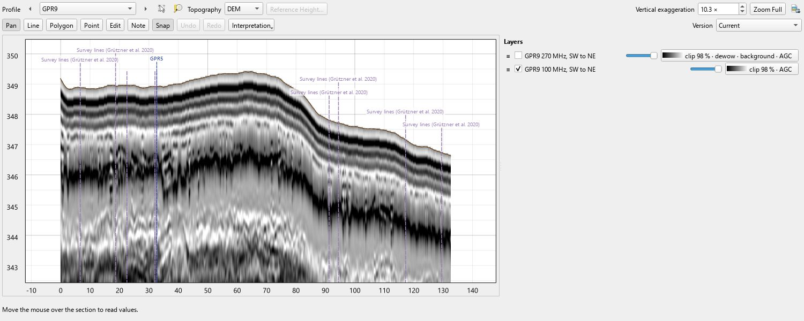
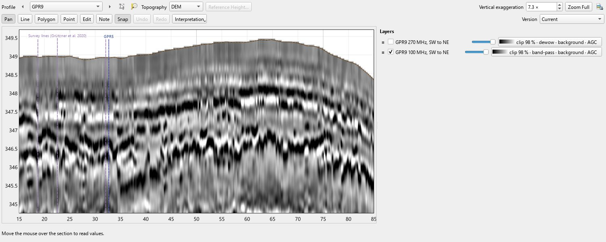

# Groundwork 0.17.0: seismic reflection sections and ground-penetrating radar

Processed seismic sections and radargrams now stand on your profiles, in depth, next to the
resistivity models, boreholes and geology. You draw on them with the same tools as on any
other section.

## Seismic reflection sections from SEG-Y

*The Vaud demo, line VD-P760057. Data: Federal Office of Topography swisstopo.*

- **Add Data…** takes a `.sgy` or `.segy` file. It reads the headers and shows what the file
  holds: traces, samples, the time range and the depth reached.
- **In depth:** type one velocity, or a short table of time against velocity, as average,
  interval or RMS (stacking) velocities. Groundwork never assumes one. The plate states the
  velocity used under the section.
- **Hung where it belongs:** from the datum of the processing sheet, or from the ground line.
- **Placed by** the positions in the file, a trace spacing, or a small coordinate file beside
  it. Files without coordinates are placed by their start and end points, like a model.
- **Text Header…** shows the 40 lines at the start of the file, where the datum and the
  velocities are often written.
- You can change the velocity and the datum later in **Dataset info**. The picture moves;
  your drawings stay at their heights, and Groundwork asks first.

*Picking a reflector with the interpretation tools. Data: Federal Office of Topography
swisstopo.*

Groundwork reads SEG-Y through **segyio**, a small free library. The first time you choose a
SEG-Y file, Add Data offers **Install segyio**; one click downloads it (about 0.4 MB) into a
folder of your QGIS profile. Nothing is installed without that click, and the page says how to
install it without internet. See
[Reflection sections](../user/howto/reflection-sections.md#segyio).

## Ground-penetrating radar

*A 270 MHz radargram over the resistivity model of the same line, the top 8 m.
Data: Grützner et al. 2020, PANGAEA, CC BY 4.0. Terrain: ARSO (Slovenian Environment Agency).*

- **GSSI `.DZT`** and **pulseEKKO `.DT1` / `.HD`** files are read directly, with no extra
  library.
- Type the radar velocity in m/ns, or the dielectric constant: either fills the other.
- **Time zero** comes from the file, or is estimated from the first arrival. Several files
  added together each get their own.
- The radargram hangs from the ground line and follows the terrain. The ground under it is
  smoothed over 2 m, so the steps of an elevation model do not show as seams.
- **From** and **To** show where the file lies along the profile. **Fit the file between these
  two points** stretches it when both ends are better known than the wheel.
- **Two antennas on one line** are two layers on the same profile: show one at a time, or lay
  one over the other.

### A clear picture from the start

A new radargram starts with a look that removes the antenna's ringing: a band-pass around the
antenna's frequency, the background of the line taken away, and AGC. Reflections show without
opening a dialog.

*Line GPR9, 100 MHz, the upper 6 to 8 m: above with AGC only, below with the start look.
Data: Grützner et al. 2020, PANGAEA, CC BY 4.0.*

See [Ground-penetrating radar](../user/howto/gpr.md).

## The picture, not the data

**Display…** of a section or radargram has clip, AGC, gain with time, trace balance, swap
polarity and a band-pass; for radar also dewow and background removal. They change only the
picture. The readout under the mouse always shows the file's own amplitude, and the files are
never changed. **Apply Style to All Sections** gives the other sections of the same kind the
same look; a radargram of another antenna gets it fitted to its frequency.

Sections and radargrams also appear on report plates, with a small amplitude key, and in the
3D view as section pictures.

## What is not covered yet

- Other radar makers (MALÅ, IDS, ImpulseRadar, 3D-Radar) and the GPS files beside GSSI
  files. Export such data as SEG-Y to load them as a reflection section.
- Processing: no migration, statics, muting or velocity analysis.
- Unstacked records (shot or CDP gathers) get a warning; 3D volumes are not read.
- One velocity, or one velocity function, per section: none that changes along the line.

## In the section panel

- **Show down to (m)** in **Display…** draws a section only down to the depth you type. Zoom
  Full, plates and the 3D view fit the part shown.
- **Layers** can be put in order by dragging, or with **Move Up** and **Move Down** in a
  layer's menu. The top row is drawn on top, as in QGIS. Plates and the 3D view follow.
- **Contour lines** take one colour of your choice and a line width.
- Two profiles that run along each other get one crossing marker for the shared stretch,
  labelled for example *along 165–260 m*, instead of a row of markers.
- **Topography** says where the ground comes from: *DEM* for a line drawn on the map, *Model
  top* when only a model gives heights.
- The **Layers** list stays as wide as you dragged it, and opens wide enough for its names.
- **Add Data** says when a model on a new line will have no heights, and how to give it some.
- The ground from an elevation model is smoother: it is interpolated between pixels.

## Demos

- **Vaud** (new): two crossing swisstopo reflection lines of about 8.5 km, with the datum and
  velocities of the original section sheet, on a 10 m swissALTI3D elevation model. Data:
  Federal Office of Topography swisstopo.
- The other demos are unchanged.

## Changes in existing projects

What a project from 0.16 shows differently:

- **Ground from an elevation model.** The ground line moves a little, by up to half the height
  change across one pixel: centimetres to decimetres on a 1 m model on a slope, nothing on
  flat ground. Models hung from that ground move with it. Your drawings stay at their stored
  heights, so on a slope they can sit that far off the boundary they were drawn on.
- **Profiles that run along each other** show one marker, one tie strip and one row in the
  ties panel for the shared stretch.
- **The first opening** reads each model file again and makes the 3D section pictures again,
  once. It takes as long as a first read did; after that it is quick again.
- **Vertical exaggeration** typed for one profile stays with that profile. Other profiles open
  at Auto.
- **Plates with deep data** cut them at the bottom of the frame; the top of the section stays
  in place.

## Fixes

- A smooth model zoomed in is drawn smoothly between its grid points, not as small squares,
  and it reaches up to the ground line. When a typed **Grid cell** is finer than the grid
  allows, **Display…** says at which size the model is drawn.
- Removing a dataset also removes what was remembered for it beside the project.
- When a plate is laid out again, its colour bars follow the order of the layers.

## Updating

Install `groundwork_geophysics-0.17.0.zip` (Plugins → Manage and Install Plugins… → Install
from ZIP). Projects need no update. For SEG-Y files, install segyio once from Add Data.
