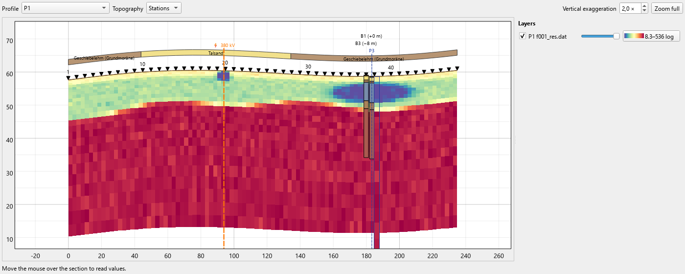
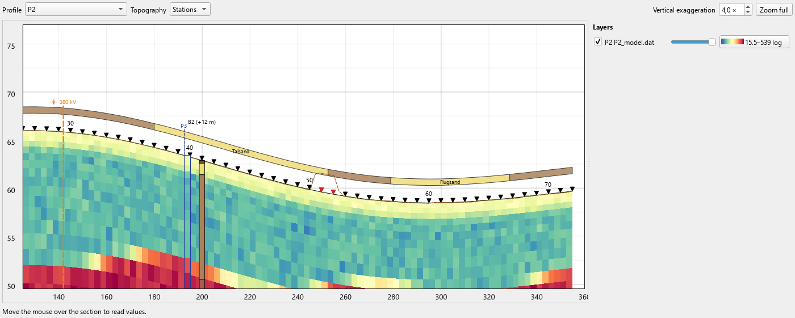
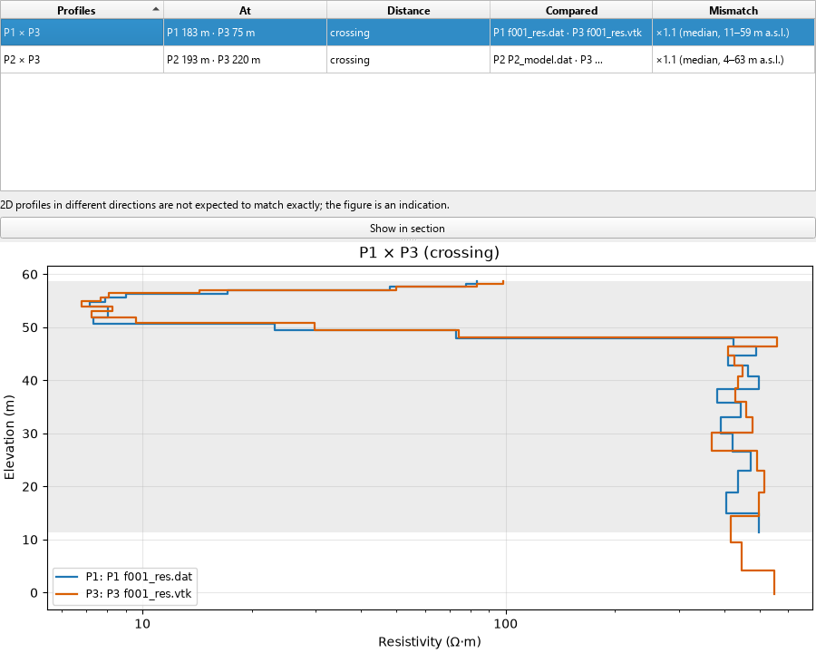

# Geophysics Workbench 0.2.0: context on the section

This release draws what lies around your profile directly on the section: powerlines and
other lines that cross it, boreholes with their logs, the surface geology, a DEM, and the
other profiles where they cross. You can judge an anomaly against what you know about
the site without leaving the section.

## What's new

- **Crossing lines on the section.** Where a line layer crosses the profile, the section
  shows a dashed vertical line with its label. Powerlines are orange with a ⚡ sign.
  Any line layer of your project works: roads, rivers, pipes.
- **Boreholes with their logs.** Boreholes near the profile are drawn as a column
  coloured by lithology, at their true elevation, labelled with their distance from the
  line (for example "B3 (−8 m)"). Points such as pylons are drawn as a black diamond.
- **Surface geology band.** A coloured band above the section shows the geological unit
  at the surface along the profile, with the unit names.
- **DEM check.** A brown dashed line shows the DEM along the profile. Stations whose
  height differs from the DEM by more than the tolerance (1 m) are drawn red. In the
  section panel, **Topography** lets you hang depth models from the DEM instead of the
  station heights.
- **Profile ties.** Where two profiles cross, the section shows the other profile's
  model as a thin framed strip beside the tie line, in this section's own colour scale,
  so equal values look equal. **Geophysics Workbench → Profile ties…** lists every
  crossing with how far the two models differ, and plots both against elevation.
- **One dialog for it all.** **Geophysics Workbench → Context layers…** chooses which
  layers are drawn, and sets the distance from the line (**Buffer**). The choice is saved
  in the QGIS project, so save the project to keep it.

## How to update

1. **Plugins → Manage and Install Plugins… → Install from ZIP** (German QGIS:
   **Erweiterungen → Erweiterungen verwalten und installieren… → Aus ZIP installieren**).
2. Choose `geophysics_workbench-0.2.0.zip` and click **Install Plugin** (German:
   **Erweiterung installieren**). It replaces 0.1.1.
3. Restart QGIS.
4. **The demo is new.** Unzip `geophysics_workbench-demo-0.2.0.zip` into a new, empty
   folder. The old demo folder has no boreholes, geology or DEM. Your own projects stay
   as they are.

The menu is called **Geophysics Workbench** in both languages, and the plugin's own menu
items and buttons are in English in German QGIS too.

**Tip:** the labels above the section need room. If the band or the labels are cut off
at the top of the section panel, make the panel taller by dragging its top edge, or
scroll the mouse wheel over the section to zoom out a little.

## What to try

1. **Open the demo and pick P1.** **Project → Open…** (German: **Projekt → Öffnen…**)
   and choose `demo_project.qgz` in the new folder. You now also see boreholes, a pylon,
   the surface geology and a DEM (hidden in the layer list). Then **Geophysics Workbench
   → Pick profile on map** and click the P1 line. The section shows the orange "380 kV"
   powerline crossing at 94 m, the geology band (Geschiebelehm, Talsand, Geschiebelehm),
   boreholes B3 and B1 near 180 m, and the P3 tie at 183 m.
2. **Find the powerline and the anomaly under the powerline crossing.** Directly under
   the orange line at 94 m there is a small, very conductive block (about 5 Ω·m) in the
   top 3 m, about 8 m wide. Is it geology or the line? Some clues: it sits exactly under
   the crossing, it is small and shallow, the ground on both sides is normal, and the
   band says Talsand there, which is not usually that conductive. (In the demo it is
   planted on purpose, as an effect of the line's earthing.) Only one pylon of this
   line lies in the demo area, about 72 m from the profiles, so no pylon appears on a
   section at the default buffer of 25 m. Set the buffer to 75 m in step 5 to see it
   as "Mast 1".
3. **Hover over borehole B1 and read its log.** Move the mouse down the B1 column (at
   183 m, labelled "B1 (+0 m)"). The line under the section shows the layer at that
   depth, for example "Borehole B1 (+0 m): 2.0–8.0 m Ton". The clay (Ton, blue-grey) in
   B1 and B3 matches the blue conductive lens around them. Next to B1 is the P3 strip,
   framed in blue: P3's model at the crossing, drawn in P1's colours. The same blue
   lens is in it, so the two profiles agree there. Hover over the strip to read P3's
   value.
4. **Open Profile ties… and compare P1 × P3.** **Geophysics Workbench → Profile ties…**
   opens a panel on the right. Click the row **P1 × P3**: the mismatch is "×1.1", and the
   plot shows both models against elevation, nearly on top of each other. 2D profiles in
   different directions never match exactly, so read the figure as an indication.
   **Show in section** opens P1 with a red dashed line at the tie.
5. **In Context layers…, raise the buffer to 35 m and watch B4 appear on P3.**
   **Geophysics Workbench → Context layers…**, set **Buffer (m)** to 35 and click **OK**.
   Open P3 in the section panel: borehole B4 now appears at 265 m, labelled
   "B4 (+30 m)", because it lies 30 m from the line. Set the buffer back to 25 m
   afterwards.
6. **On P2, switch Topography to DEM and look at the embankment.** Open P2. First, with
   **Topography** on **Stations**, look near 250 m: the brown dashed DEM line rises
   about 2 m above the station line there (a road embankment), and the two station
   triangles at 250 m and 255 m are red. The bump is small at 2 ×, so scroll the mouse
   wheel over 250 m to zoom in, or raise **Vertical exaggeration** to 4 or 5. Hover
   there: the line under the section shows, for example, "DEM 61.4 m (stations −1.9 m)".
   Now switch **Topography** to **DEM**: the black surface and the whole model are lifted
   by 2 m over the embankment, and the red marks go away. Which is right depends on
   where the electrodes really stood: the station heights are what was measured, the DEM
   shows the road. The choice is saved with the profile, so switch back to **Stations**
   when you are done.
7. **Add one of your own layers, such as a road or river layer, as a crossing line.**
   Add a line layer that crosses one of the profiles to the project (it may be in any
   coordinate system). If you have none at hand, draw one: **Layer → Create Layer → New
   Temporary Scratch Layer…** (German: **Layer → Layer erstellen → Neuer
   Temporärlayer…**), geometry type LineString, a text field `name`; then add a line
   across P1 with **Add Line Feature** (German: **Linienobjekt hinzufügen**) and give it a
   name. In **Context layers…**, under **Crossing lines**, tick your layer, choose its
   label field and click **OK**. A grey dashed line with its label appears in P1's
   section where your line crosses it.
8. **Edit a borehole log value in its attribute table and watch the section update.**
   In the layer list, right-click **Borehole logs → Open Attribute Table** (German:
   **Attributtabelle öffnen**) and turn on editing with the pencil, **Toggle Editing**
   (German: **Bearbeitungsstatus umschalten**). In B1's row from 2.0 to 8.0 m, change the
   lithology from `Ton` to `Sand`. Within a second, that part of the B1 column in the
   section turns from blue-grey to yellow. Click the pencil again and choose
   **Discard** (German: **Verwerfen**) to keep the demo as it was.

## Known limits

- Ties compare models only; measured apparent resistivity follows in M4.
- The column importer and control points follow in 0.2.5.
- The labels above the section take a fixed amount of room, so in a low section panel
  they can be cut off at the top (see the tip above).
- Where boreholes stand right on a tie line, the P3 strip moves beside the borehole
  column, so it can sit a little away from the tie line.
- The colour of a tie strip follows the top visible model of this section. A section
  without a model of the same kind (for example only chargeability) keeps the other
  profile's colours.
- Everything else in the 0.1.0 and 0.1.1 notes still applies.

Please send feedback on what you tried, what was unclear and what you missed.
