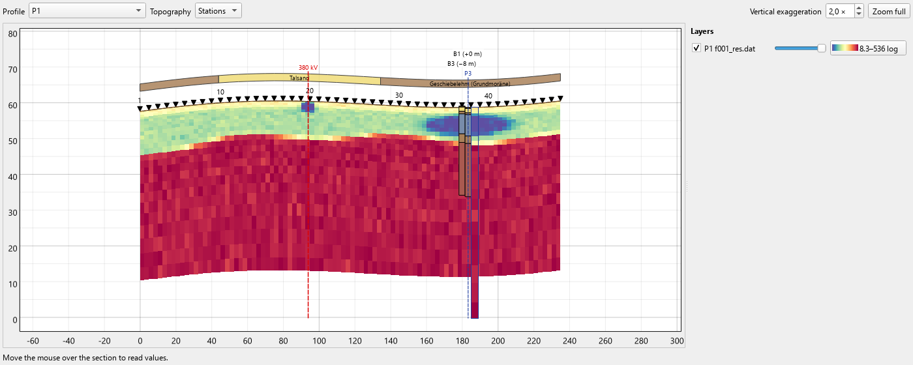
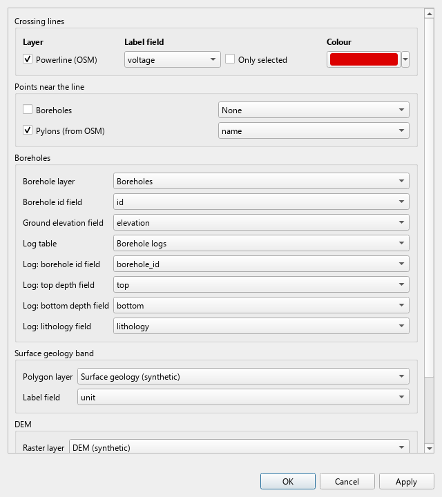

# Geophysics Workbench 0.2.1: flexible crossing lines and a live context dialog

This release makes the crossing lines on the section yours to control. Every line layer of
your project can cross the section, in its own colour and with a label of your choice,
and the **Context layers…** dialog stays open beside the map so you can see the effect of
each change at once.

## What's new

- **Any line layer can cross the section.** The crossing lines come from every line layer
  in the project, except the workbench's own profiles and stations. A layer you have
  never ticked or unticked follows its visibility on the map, live.
- **One row per layer, with four settings.** Each row has a tick, a label field,
  **Only selected** (the section then follows the selection on the map, live) and a
  colour. The colour starts as the layer's colour on the map.
- **Crossings in your colour.** A crossing is a dashed line in the row's colour, and its
  label has that colour too. A value is shown with "kV" only when the label field is
  named like *volt* or *spannung*; other fields show their value as it is.
- **A dialog that stays open.** **Context layers…** no longer blocks QGIS. It has **OK**,
  **Apply** (German QGIS: **Anwenden**) and **Cancel**. The section also updates by
  itself when you change the selection, a layer's style or visibility, or add a layer.
- **The "Powerline" checkbox is gone**, and with it the ⚡ sign and the fixed orange.
  The demo's powerline is now an ordinary row, red like on the map.

## How to update

1. **Plugins → Manage and Install Plugins… → Install from ZIP** (German QGIS:
   **Erweiterungen → Erweiterungen verwalten und installieren… → Aus ZIP installieren**).
2. Choose `geophysics_workbench-0.2.1.zip` and click **Install Plugin** (German:
   **Erweiterung installieren**). It replaces 0.2.0.
3. Restart QGIS.
4. **The demo changed a little.** Unzip `geophysics_workbench-demo-0.2.1.zip` into a new,
   empty folder; its powerline now uses the new row settings. Your own projects keep
   their saved choices: an old "Powerline" setting becomes an ordinary row.

## What to try

1. **Open Context layers… and keep it open beside the section.** Open the demo project,
   pick P1 (**Geophysics Workbench → Pick profile on map**), then **Geophysics Workbench →
   Context layers…**. The dialog does not block the map. The row **Powerline (OSM)** is
   ticked, with the label field `voltage` and a red colour. The section shows the red
   dashed crossing "380 kV" at 94 m.
2. **Change the powerline's colour and click Anwenden.** Click the colour button of the
   powerline row, choose blue, and click **Apply** (German: **Anwenden**). The dashed line
   and its label turn blue at once; the dialog stays open. Set it back to red when done.
3. **Add a roads or rivers layer to the map and watch it appear on the section.** Add
   any line layer that crosses P1 (**Layer → Add Layer…**, or draw one in a scratch layer).
   A new row appears in the open dialog, and the crossing appears on the section with the
   layer's map colour. Pick its label field in the dialog and click **Apply**.
4. **Tick "Only selected" and select a single line on the map.** In the powerline row tick
   **Only selected** and click **Apply**. Nothing is drawn until you select a line; then
   select one line feature with the **Select Features** tool and the section shows only
   that one. Change the selection and the section follows.
5. **Hide a layer on the map, then tick it in the dialog anyway.** Untick the layer in the
   layer list: its crossing disappears from the section (as long as you have not touched
   its tick in the dialog). Now tick it in the dialog and click **Apply**: the crossing
   comes back, although the layer is still hidden on the map.

## Known limits

- Once a row's tick has been clicked, it no longer follows the map visibility. Removing
  the layer and adding it again resets it.
- Point, borehole, band and DEM choices do not update live while the dialog is open;
  they apply when you click **Apply** or **OK**.
- Everything else in the 0.2.0 notes still applies.

Please send feedback on what you tried, what was unclear and what you missed.
