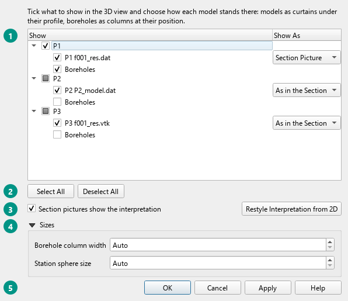

# The 3D view

How to see your models, boreholes and interpretation together in QGIS's 3D view.

## Show in 3D

**Groundwork → Show in 3D…** lists every profile with its models and its **Boreholes**. Tick what you want to see, choose under **Show As** how each model stands there, and press **Apply** or **OK**. **Apply** shows your choice in the 3D view and keeps the dialog open, so you can try **Point Cloud** against **Section Picture** and look at the result; **OK** does the same and closes it. The dialog does not block QGIS: you can turn the 3D view while it is open.

| | Part of the dialog | What it does |
|---|---|---|
| ① | The list, **Show As** | what stands in 3D, and how each model stands there |
| ② | **Select All**, **Deselect All** | tick or untick everything at once |
| ③ | **Section pictures show the interpretation**, **Restyle Interpretation from 2D** | the interpretation painted into the pictures; its 3D style back to its 2D style |
| ④ | **Sizes** | the borehole columns' width and the station spheres' size |
| ⑤ | **Apply**, **OK** | show the choice (Apply keeps the dialog open) |

- a **model** stands as a curtain under its profile, at its real elevation: **As in the Section** (the default) draws it the way its section draws it, **Point Cloud** and **Section Picture** are explained below;
- **Boreholes** are the boreholes the profile's section shows (not the ones hidden there), as round columns at their real map position, from the collar down, each interval in its colour from the section and about as wide as two thirds of the station spacing (or as wide as you set under **Sizes**, see below). Each borehole's **name** floats 1 m above its column. QGIS draws all texts of one annotation layer at one height, so the names come in small layers by collar height (in 0.5 m steps), in the group **Borehole names in 3D**. A profile whose section shows no boreholes has no **Boreholes** entry;
- every profile with something ticked also shows its **ground line**, the line its section draws as the ground surface, in the section's ground colour (black), in the layer **Ground in 3D**: with the terrain switched off, it shows where each profile runs and how high its ground lies;
- each such profile's **name** floats a little above the start of its ground line, as QGIS draws text annotations in the 3D view: in the format of the profile labels on the map. Each profile has its own small annotation layer in the group **Profile names in 3D** (QGIS draws all texts of one annotation layer at one height, and profiles lie at different heights). To change the look, open a name's layer properties → **3D View**: there you can also set its text format or switch on a callout line to the ground. The map labels the profiles already, so these layers stay out of the 2D map;
- ticking a profile ticks all of it;
- a profile without real heights (a local section) is greyed out: give it a reference height first, see [Reference height](reference-height.md);
- a model's **Show As** can be chosen while the model is ticked.

Below the list:

- **Section pictures show the interpretation** paints the interpretation into the section pictures (see below);
- **Restyle Interpretation from 2D** gives the interpretation's 3D style back to its 2D style at once (see [Stations and the interpretation in 3D](#stations-and-the-interpretation-in-3d));
- **Sizes** (click to open): the **Borehole column width** and the **Station sphere size**, both diameters in metres. **Auto** sizes them from the distance between the stations; the tooltip says how big that is. The clear button next to a size goes back to **Auto**.

Nothing is shown in 3D until you ask. Untick a model or a profile's boreholes to take them out again.

If no 3D map view is open when you press **Apply** or **OK**, a new one opens, ready to look at: the terrain switched off, eye-dome lighting on and the camera on what you ticked, seen at an angle from the long side of the profiles. A 3D map view you already have open is used as it is: its settings and camera are not touched.

Everything **Show in 3D…** makes sits in one collapsed group **3D View** inside the Groundwork group: untick that group to hide all of it at once. A layer you move out of it stays where you put it.

## Looking at one profile

The **3D** button next to the profile list in the section panel (the same entries are in the list's right-click menu):

- **Look at Profile in 3D** turns the 3D view side-on to the open profile;
- **Cut 3D View Along Profile** does the same and cuts the 3D view down to a slab along the profile (QGIS's cross section, a little wider than the profile's bends). Everything outside the slab is left out, so the curtain shows through a terrain or a DEM you keep switched on. **Remove 3D Cut** in the same menu shows everything again;
- **Show in 3D…** opens the dialog.

With no 3D map view open, a ready one opens first. If nothing of the profile is shown in 3D yet, its models (and its boreholes, when its section shows some) are ticked and shown first; other profiles stay as they are, and **Show in 3D…** lists the new ticks.

## A curtain looks like its section

A curtain follows the model's **display** in the section panel, and changes when you change it there:

| Section display | In 3D |
|---|---|
| **Cells** | one vertical cell per model cell, in **Models in 3D** |
| **Smooth** | a point cloud of the section's smooth field, one layer per model in the group **Smooth models in 3D** |
| **Contours** | the contour lines, at the section's levels and in its contour colour, in **Contours in 3D** |
| **Smooth + contours** | the point cloud and the contour lines |

The colour scale and the coverage fade follow too. In **Cells**, a cell the section fades (low coverage, fade mode **Fade**) stands see-through, as faint as in the section; with fade mode **Blank** it is left out. In the smooth point cloud, the faded part is left out.

Two models of one profile shown as cells (say resistivity and chargeability, or two time-lapse models) stand a little apart, in the order the section stacks them: the one on top is in front from either side, so they never flicker in one plane.

**Models in 3D**, **Contours in 3D**, **Boreholes in 3D** and **Ground in 3D** are temporary layers: they are not stored in the Groundwork file, and the project saves the layers with their styles but not what they hold. They are filled from your models again once a 3D map view is open (QGIS reopens the 3D views saved with the project) or when you press **Apply** or **OK** in **Show in 3D…**. The **Profile names in 3D** and **Borehole names in 3D** are small annotation layers, saved in the project with their texts.

The 3D layers are kept up to date only while a 3D map view is open: with none open, a change in the section panel (display, colour scale, fade, data) only marks them as out of date, so no point clouds or pictures are written that nobody sees. They catch up as soon as a 3D map view opens, or when you press **OK** in **Show in 3D…**. Deleting a model or a profile takes its part out of the 3D layers at once, also with no 3D view open. If you look at them in **Qgis2threejs** instead (it has no QGIS 3D map view), or in the 3D map of a print layout (that does not count as an open 3D view either), press **OK** in **Show in 3D…** to bring them up to date before you export or print.

The **point clouds** are files: they are written to a folder next to the Groundwork file, named after it with **_3d** at the end (for `site_groundwork.gpkg`: `site_groundwork_3d`). They are made from your models whenever needed, and the plugin only ever deletes the files it wrote there. If the folder is missing when you open the project (deleted, or not copied along), QGIS asks about the unavailable layers: choose to keep them, and the curtains are written again once the project is open. The first time QGIS opens a point cloud it builds an index of it (a progress bar in the status bar), and the points show when that is done.

## Point clouds and section pictures

**Show As** in **Show in 3D…** sets each model's look on its own, so one profile can have a section picture next to another profile's point cloud:

- **As in the Section** (the default): cells, a point cloud or contour lines, following the model's display in the section as above. You can style them in QGIS and **Identify** their values.
- **Point Cloud**: the model's smooth field as a point cloud, whatever the section shows (also when it shows cells), with the contour lines when the section shows contours. Style and identify it as above.
- **Section Picture**: the model exactly as its section draws it, in whatever display it has there, contour labels included, as a picture on a curtain under its profile. All models of a profile set to **Section Picture** are painted into **one** picture, stacked as the section stacks them (each with its opacity), so they never flicker in the same plane. One layer per profile, named after the profile, in the group **Section pictures in 3D**. The picture is opaque, on the section panel's background colour: a faded or see-through model looks as it does in the panel, not see-through in 3D. Change a model's display, colour scale or fade in the section panel and the picture is drawn again. There are no values on Identify, and the look can't be restyled in QGIS: it is the section's.

With **Section pictures show the interpretation** ticked, each picture also shows the profile's interpretation over the models, exactly as the section panel draws it: fills, hatches, transparency, line styles and names. The picture is drawn again when you edit the interpretation or change its style (Symbology). Station and borehole names stay out of the picture. The interpretation's own 3D layers still stand in front of the picture; switch them off in the Layers panel if you only want the picture.

The pictures are 3D Tiles (a `.json` tileset and a `.glb` model per profile) in the same folder as the point clouds. Long profiles are drawn coarser, so that a picture stays a reasonable size; still, drawing the pictures takes a few seconds (a busy cursor shows it).

The picture layers are shown in the 3D view only, not in the 2D map: there a picture would show nothing useful and still slow down every redraw of the map. So their **scale-dependent visibility** ends at 1:1, and the Layers panel shows them greyed out; that is expected, and the 3D view is not affected by it. To see a picture in the 2D map all the same, untick **Scale Dependent Visibility** in its **Layer Properties → Rendering**; a picture you switched on that way stays so when it is drawn again.

## Opening a 3D map view

**Show in 3D…** opens a ready 3D map view when none is open (see above). To open one yourself, or to set up one you already had open:

1. **View → 3D Map Views → New 3D Map View.**
2. In the view's settings (the wrench) → **Terrain**, switch the terrain **off** to start with. The curtains hang below the ground surface, and an opaque terrain hides them. With a DEM as terrain, lower its opacity or look from below.
3. For the point clouds, switch on **eye-dome lighting** in the point cloud's **Layer Properties → 3D View**: without it, a point cloud looks flat and dark.
4. Turn the view with the middle mouse button or Ctrl + drag; zoom with the wheel.

A 3D view asks every map layer it shows for its whole scene, not just for what is on screen, for the 3D layers and for the image it lays on the terrain. A web layer that covers a large area, such as a state-wide WFS of boreholes, then keeps downloading for a long time, and the terrain stays white until it is done. Switch such layers off while you use the 3D view, or save the part you need as a local layer (**Export → Save Features As…** with an extent).

## Stations and the interpretation in 3D

The **stations** stand as small spheres at their surveyed height, in the outline colour of their map symbol, sized to the distance between them or to the **Station sphere size** set in **Show in 3D…**; stations without a height are left out. A size you set in the stations' own **3D View** properties is yours: **Show in 3D…** no longer changes it.

The interpretation lines, polygons and points (3D) stand at the depth you drew them: lines as lines a few pixels wide, polygons as flat panels, points as spheres, each entity in its colour from the 2D legend. They follow their 2D style (Symbology), also when you change it: the colour, the fill's transparency and the outline. A hatched or patterned fill shows in its colour, half see-through, and a fill switched off shows only the outline: QGIS's 3D view can't draw patterns on upright polygons. Lines take their width. This works while the 2D style is the one with a colour per entity (Categorized by **feature_id**, as the plugin sets it up): if you categorize the layer by another field, such as the type, or choose another kind of style, the 3D style stays as it was. If an entity should look different in 3D, restyle it in the layer's properties → **3D View**: an entity you restyled there no longer follows its 2D style. To make every entity follow its 2D style again (also after you replaced or removed a layer's 3D style), press **Restyle Interpretation from 2D** in **Show in 3D…**.

An edit in the section (a new piece, a moved vertex, a deleted one) shows in the open 3D view as soon as it is saved.

The interpretation lies in the same plane as its profile's curtain. So that it never flickers with the curtain or hides behind it, cells and section pictures are drawn as two faces, each standing a little behind the plane as seen from its side (5 to 50 cm, depending on the profile's length): from either side, the interpretation is in front. Point clouds are drawn as they are.

## Pointing in 3D shows the place in the section

Move the mouse over a curtain, a section picture, a borehole column or a point cloud in the 3D view (with no mouse button held): when it belongs to the profile open in the section panel, the panel's cursor moves to that place, with a small ring at its elevation and the readout (chainage, elevation, depth, value) below the section, and the marker on the 2D map moves to the same place on the profile line. Over anything else, or off the 3D view, the cursor hides. It only follows while the section panel is open with a profile in it. Moving the mouse never switches the profile.

A **click** does: click (left button, without dragging) on the curtain, section picture or point cloud of another profile (or a borehole column standing on its line), and the section panel opens that profile, with its cursor at the place you clicked. If the panel was closed, it opens. A drag turns or moves the view as usual and switches nothing, and the click still does whatever QGIS's current 3D tool does (identify, measure and so on).

## Working with the layers

- **Identify** a cell: **value**, **coverage**, **resolved** (0 or 1) and **faded** (1 where the section fades it). Identify a point of a smooth curtain: its **Value** (and **Log10Value**).
- **Models in 3D** has two rules in its **3D View** properties, **Cells** and **Faded cells (low coverage)**: change the see-through of the faded ones there. A 3D style you set up yourself stays.
- **Only the resolved part:** filter **Models in 3D** with `"resolved" = 1`. When the section fades low coverage, the cells below the threshold are left out of the curtain anyway.
- **Style a smooth curtain by value:** in the point cloud's properties → **Symbology**, choose **Attribute by Ramp** on **Log10Value** (or **Value** on a linear scale) and a colour ramp; the 3D view follows the 2D style. Your style stays when the curtain is rebuilt.
- The point size is in the point cloud's **3D View** properties. So is the **Maximum screen space error**: the plugin sets it to 0.5 px, so a curtain seen from a distance shows its dense points (with QGIS's default of 3 px it shows a thinned-out cloud, which eye-dome lighting turns almost black). A value you set there stays.
- **Identify** a borehole interval in the 3D view: its **borehole**, **top** and **bottom** depth and its **text**.
- **Qgis2threejs** reads the same layers: choose **Polygon** for the cells, **Polygon** extruded by the **height** field for the boreholes and **Line** for the contour lines and the ground lines, with the height from the Z values, and the point clouds as point clouds.
- A very large model (hundreds of thousands of cells) makes the 3D view slow in **Cells**; show it **Smooth** or show fewer models at once.
