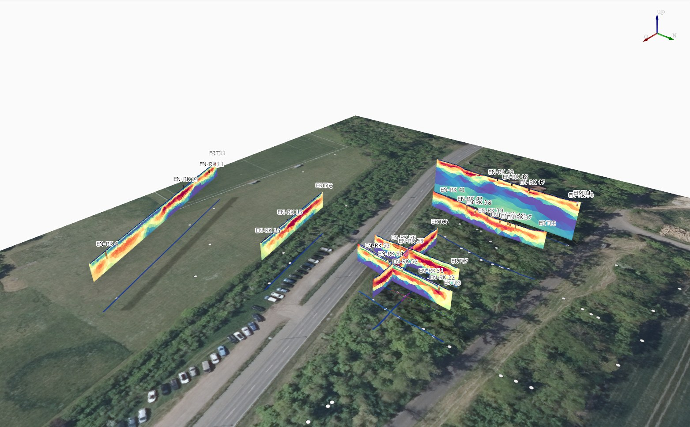
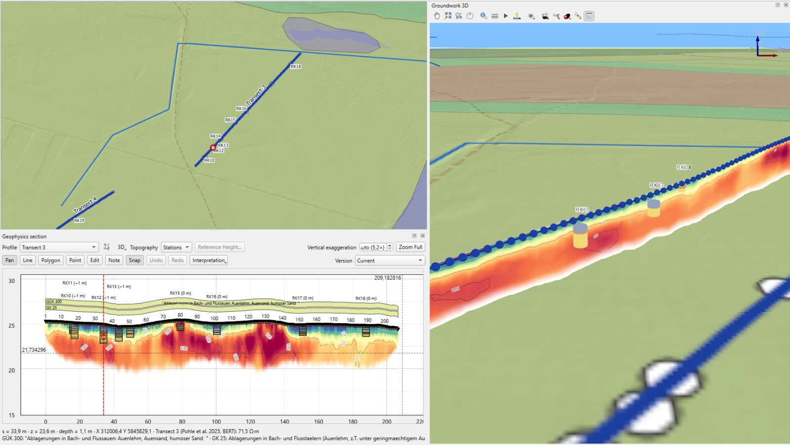
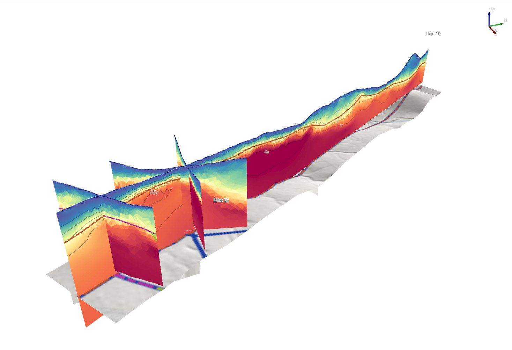
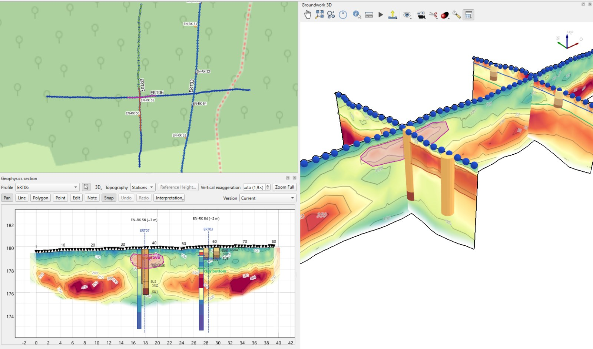

# The 3D view

How to see your models, boreholes and interpretation together in QGIS's 3D view.

*Aerial image: © GDI-Th, dl-de/by-2-0.*

## In short

1. **Groundwork → Show in 3D…**
2. Tick the profiles, models and boreholes to show.
3. **Apply**. If no 3D map view is open, a ready one opens: terrain off, eye-dome lighting on,
   the camera on what you ticked.
4. Turn the view with the middle mouse button or Ctrl + drag; zoom with the wheel.

Each model stands as a **curtain** under its profile, at its real elevation. Nothing is shown
in 3D until you ask; untick something to take it out again.

## Show in 3D

| | Part of the dialog | What it does |
|---|---|---|
| ① | The list, **Show As** | what stands in 3D, and how each model stands there |
| ② | **Select All**, **Deselect All** | tick or untick everything at once |
| ③ | **Section pictures show the interpretation**, **Restyle Interpretation from 2D** | the interpretation painted into the pictures; its 3D style back to its 2D style |
| ④ | **Sizes** | the borehole columns' width and the station spheres' size |
| ⑤ | **Apply**, **OK** | show the choice; **Apply** keeps the dialog open |

The dialog does not block QGIS: turn the 3D view while it is open, and press **Apply** again
to compare looks.

- **Models**: each one's **Show As** sets how it stands (see [How a model stands in
  3D](#how-a-model-stands-in-3d)).
- **Boreholes**: the boreholes the profile's section shows (not the ones hidden there), as
  round columns from the collar down, each interval in its colour from the section, with the
  name above.
- With anything of a profile ticked, its **ground line** (the section's ground surface, in
  black) and its **name** show too.
- A profile without real heights (a local section) is greyed out: give it a
  [reference height](reference-height.md) first.
- **Sizes**: **Borehole column width** and **Station sphere size**, diameters in metres.
  **Auto** sizes them from the distance between the stations.

*Map: GK 25 © LBGR, DGM1 © GeoBasis-DE/LGB, both dl-de/by-2-0; © OpenStreetMap contributors.*

A 3D map view you already have open is used as it is: its settings and camera are not touched.
Everything **Show in 3D…** makes sits in one group **3D View** inside the Groundwork group:
untick it to hide all of it at once.

## Looking at one profile

The **3D** button next to the profile list in the section panel (the same entries are in the
list's right-click menu):

- **Look at Profile in 3D** turns the 3D view side-on to the open profile;
- **Cut 3D View Along Profile** does the same and leaves out everything outside a slab along
  the profile, so the curtain shows through a terrain you keep on. **Remove 3D Cut** shows
  everything again;
- **Show in 3D…** opens the dialog.

*Elevation: USGS 3D Elevation Program.*

If nothing of the profile is shown in 3D yet, its models and boreholes are ticked and shown
first.

## How a model stands in 3D

**Show As** sets each model's look on its own:

| Show As | In 3D | Style in QGIS, **Identify** values |
|---|---|---|
| **As in the Section** (the default) | as the section panel draws it, see below | yes |
| **Point Cloud** | the model's smooth field as points, with the contour lines when the section shows contours | yes |
| **Section Picture** | the section exactly as the panel draws it, contour labels included | no: it is the section's look |

**As in the Section** follows the model's [display](section-panel.md#how-a-model-is-drawn), and
changes when you change it there:

| Section display | In 3D |
|---|---|
| **Cells** | one upright cell per model cell, in **Models in 3D** |
| **Smooth** | a point cloud of the smooth field, in **Smooth models in 3D** |
| **Contours** | the contour lines, in **Contours in 3D** |
| **Smooth + contours** | the point cloud and the contour lines |

The colour scale, the [interpolation](section-panel.md#interpolation) and the coverage fade
follow too: a faded cell stands see-through, a blanked one is left out, and the faded part of a
point cloud is left out.

To see a whole survey alike in 3D, style one model, right-click it in the section's layer list
→ **Apply Style to All Sections**, then tick the profiles in **Show in 3D…** with **As in the
Section**.

**Section pictures**: all models of a profile set to **Section Picture** are painted into one
picture, stacked as the section stacks them, in the group **Section pictures in 3D**. With
**Section pictures show the interpretation** ticked, the picture shows the interpretation too,
as the panel draws it. A picture is opaque, on the panel's background colour, and is drawn
again when you change the model's display or the interpretation.

Two models of one profile shown as cells stand a little apart, in the section's order, so they
never flicker in one plane.

## Stations and the interpretation in 3D

- **Stations** stand as small spheres at their surveyed height, in the outline colour of their
  map symbol. Stations without a height are left out.
- The **interpretation** stands at the depth you drew it: lines as lines, polygons as flat
  panels, points as spheres, each feature in its colour from the 2D legend, with its fill's
  transparency, its outline and its line width. A hatched fill shows in its colour, half
  see-through; QGIS's 3D view can't draw patterns on upright polygons.
- It follows its 2D style (Symbology) when you change it, as long as that style is
  **Categorized** by **feature_id**, as the plugin sets it up.
- To make one feature look different in 3D, restyle it in the layer's properties → **3D View**;
  it then no longer follows 2D. **Restyle Interpretation from 2D** in **Show in 3D…** makes all
  of them follow again.
- An edit in the section shows in 3D as soon as it is saved. The interpretation is always in
  front of its curtain, from either side.

## Pointing in 3D shows the place in the section

*Map: © OpenStreetMap contributors.*

- **Move the mouse** over a curtain, section picture, point cloud or borehole column of the
  profile open in the section panel: the panel's cursor moves to that place, with its readout,
  and the marker on the map moves along the profile line.
- **Click** (without dragging) on another profile's curtain, picture, point cloud or borehole
  column: the section panel opens that profile at the place you clicked.

A drag turns the view as usual, and QGIS's current 3D tool (identify, measure) still works.

## Working with the layers

- **Identify** a cell: **value**, **coverage**, **resolved** (0 or 1) and **faded** (1 where the
  section fades it). A point of a point cloud: its **Value** (and **Log10Value**). A borehole
  interval: its **borehole**, **top**, **bottom** and **text**.
- **Only the resolved part:** filter **Models in 3D** with `"resolved" = 1`.
- **See-through of faded cells:** **Models in 3D** → **3D View** has two rules, **Cells** and
  **Faded cells (low coverage)**.
- **Style a point cloud by value:** **Symbology** → **Attribute by Ramp** on **Log10Value** (or
  **Value**). The point size and the **Maximum screen space error** (the plugin sets 0.1 px, so
  distant curtains stay dense and in colour; a value you set stays) are in its **3D View** properties.
- **Profile and borehole names:** each name's layer properties → **3D View** sets its text
  format or a callout line to the ground.
- A style or size you set yourself stays when the plugin rebuilds a layer.
- A very large model (hundreds of thousands of cells) makes **Cells** slow: show it **Smooth**,
  or fewer models at once.

### Your own 3D map view

To set up one yourself: **View → 3D Map Views → New 3D Map View**, then in its settings (the
wrench) → **Terrain**, switch the terrain off to start with; an opaque terrain hides curtains
below the ground. For point clouds, switch on **eye-dome lighting**: without it they look flat
and dark.

A 3D view asks every map layer for its whole scene. A large web layer, such as a state-wide WFS
of boreholes, keeps downloading and leaves the terrain white. Switch such layers off while you
use the 3D view, or save the part you need as a local layer (**Export → Save Features As…** with
an extent).

## Behind the scenes

- **Temporary layers.** **Models in 3D**, **Contours in 3D**, **Boreholes in 3D** and **Ground
  in 3D** are not stored in the Groundwork file; the project saves their styles, not what they
  hold. They are filled again when a 3D map view opens, or when you press **Apply** or **OK**.
- **Kept up to date while a 3D view is open.** With none open, a change in the section panel
  only marks the 3D layers as out of date; they catch up when a 3D view opens or on **OK**.
  Deleting a model or profile takes it out at once. For **Qgis2threejs** or a print layout's 3D
  map, which don't count as open 3D views, press **OK** in **Show in 3D…** first.
- **Files.** Point clouds and section pictures (3D Tiles: a `.json` and a `.glb` per profile)
  are written to a folder next to the Groundwork file, named after it with `_3d` (for
  `site_groundwork.gpkg`: `site_groundwork_3d`). The plugin only deletes files it wrote there.
  If the folder is missing when you open the project, keep the unavailable layers when QGIS
  asks: they are written again. The first time QGIS opens a point cloud, it builds an index
  (a progress bar in the status bar).
- **Pictures stay out of the 2D map.** Their visibility ends at 1:1, so the Layers panel shows
  them greyed out; the 3D view is not affected. Untick **Scale Dependent Visibility** in
  **Layer Properties → Rendering** to see one on the map. Long profiles get coarser pictures, to
  keep them a reasonable size.
- **Names in many small layers.** QGIS draws all texts of one annotation layer at one height,
  so each profile name has its own layer (**Profile names in 3D**), and borehole names come in
  layers by collar height in 0.5 m steps (**Borehole names in 3D**).
- **Two faces.** Cells and section pictures are drawn as two faces, each a little behind the
  profile's plane from its side (5 to 50 cm), so the interpretation in that plane is always in
  front. Point clouds are drawn as they are.
- **Qgis2threejs** reads the same layers: **Polygon** for the cells, **Polygon** extruded by the
  **height** field for the boreholes, **Line** for the contour and ground lines, the heights from
  the Z values, and the point clouds as point clouds.
