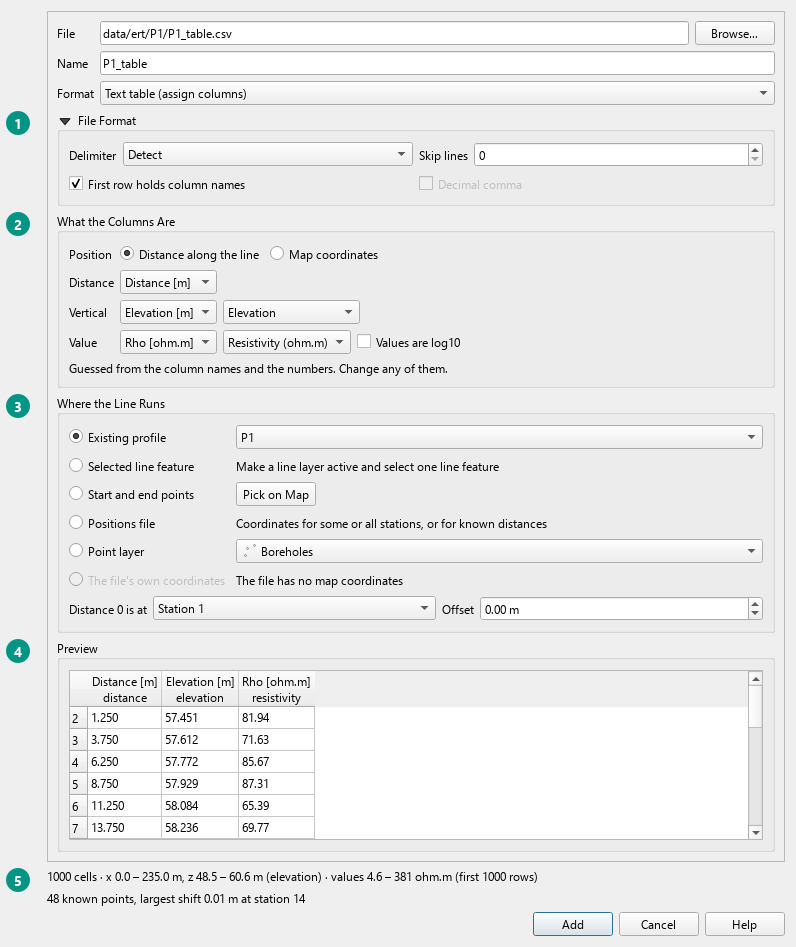

# Add data

**Groundwork → Add Data…** is the one dialog for every file. Formats the plugin knows (R2/ResIPy, ZondRes2D, VTK, BERT/pyGIMLi data, Refrapy velocity models) are recognised; for any other text table you say what the columns are. A Groundwork project must be open; a profile need not be.

| | Part | What you check |
|---|---|---|
| ① | [File Format](#file-format-text-tables-only) | How the text table is laid out: delimiter, lines to skip, column names |
| ② | [What the Columns Are](#what-the-columns-are) | Which column is the position, which the height or depth, which the value |
| ③ | [Where the Line Runs](#where-the-line-runs) | Which profile the file belongs to, or where a new one is, and where distance 0 lies |
| ④ | [Preview](#preview) | The first rows, with the role of each column |
| ⑤ | [The check result](#the-check-result) | What will be added, and any warnings, right above **Add** |

Choose the file first: the dialog fills in what it can guess. ① and ② appear only for a text table.

## Step by step

### (a) A text table in distance and depth, on a drawn line

1. Draw or select the line in QGIS, or have the profile already (**New Profile…**).
2. **Add Data…** and choose the file. Check ① **File Format**.
3. Under ② **What the Columns Are** choose Position: **Distance along the line**, Vertical: **Depth below surface**, Value: **Resistivity**, and check the columns the dialog guessed.
4. Under ③ **Where the Line Runs** choose the profile (or the selected line, or start and end points). Say where distance 0 is.
5. Look at ④ **Preview**, read ⑤ the check result, then press **Add**.

With no surveyed positions the model sits rigidly on the line: file distance 0 at the point you chose, one metre per metre. Without any heights the section is a local section (see [Reference height](reference-height.md)).

### (b) A file with map coordinates

1. **Add Data…** and choose the file. Under ② set Position to **Map coordinates**, and pick the easting and northing columns and their coordinate system.
2. Vertical is usually **Elevation**.
3. Under ③ choose **The file's own coordinates**, or an existing profile.
4. Read ⑤, then press **Add**.

What happens to the points:

- Each point is projected onto the line.
- Points past the ends of the line (a model's padding) are placed along the line's first or last segment extended: before the start they get a negative distance, after the end a distance beyond the line's length. The check result says how many lie beyond the ends.
- A profile made from the file's own coordinates follows the cells' map positions: the positions are ordered along the line and simplified to its bends.
- A model that covers an area instead of following a line is refused.
- Lines you draw or import are used as drawn; GPS tracks are not smoothed.
- The map shows the line before you save.

To add surveyed positions afterwards, see [Placement on the electrodes](placement.md#adding-surveyed-positions-later).

## The parts in detail

### File Format (text tables only)

① says how the table is laid out.

- **Delimiter**: Detect, Comma, Semicolon, Tab or Space.
- **Skip lines**: the lines before the table.
- **First row holds column names**.
- **Decimal comma**: off while Detect is chosen (Detect decides).

### What the Columns Are

② says what each column means.

- **Position**: a **distance along the line**, or **map coordinates** (easting and northing, with their coordinate system; a file that looks like degrees preselects EPSG:4326).
- **Vertical** has three meanings:
  - **Elevation**: heights above sea level;
  - **Depth below surface**: the depths must be all positive or all negative (the size is used); a column with both signs is refused with a message;
  - **Local height**: heights against an arbitrary zero. The section is drawn as a *local section*, see [Reference height](reference-height.md).
- **Value**: **Resistivity** (Ω·m), **P-wave velocity** (m/s) or **Other** (type a name and a unit). Tick **Values are log10** when the column holds log10 of the values.
- **Coverage** (optional): the inversion's coverage or sensitivity per cell, used to fade the parts of the section it does not resolve.

How the first guess is made:

- from the column names; a unit in brackets is ignored, so `Rho [ohm.m]` is found;
- from the numbers; a constant column is never a position;
- text columns, such as remarks, are shown and marked "not used".

The dialog remembers the last table settings and column roles and offers them again for a file with the same columns.

### Where the Line Runs

③ says which profile the file belongs to, or where a new one is:

- **Existing profile**: preselected when a profile is open; the group is then one line, and **Other…** opens it;
- **Selected line feature** on the map;
- **Start and end points**: type them or use **Pick on Map**;
- **Positions file** or **Point layer**;
- **The file's own coordinates** (map coordinates only).

**Distance 0 is at** the start of the line, the end of the line, or station 1 (when the profile has stations), plus an **Offset** you can type.

Two rows at the top of the dialog belong here:

- **Method**: ERT or Seismic refraction. It is preselected from the file (a velocity file proposes Seismic refraction) and gives the dataset its type, for example *Seismic refraction Vp model*, which the plate's title block, colour bar and layer tooltip show. Stations made by the import are electrodes or geophones. Measured ERT data are always ERT.
- **Station set** appears when the profile has several sets.

The new line and its points are drawn on the map while the dialog is open.

### Preview

④ shows the first rows, with each column's role under its name.

### The check result

⑤ is a fixed block right above **Add**; it stays in view while the parts above scroll. It shows:

- a summary line of what will be added;
- the fit report (see [Placement](placement.md#known-points-and-the-fit-report));
- a note about electrodes (see [Placement](placement.md#electrodes-you-did-not-import));
- warnings.

Good to know:

- For a long file the summary is made from the first 1000 rows, and says so. It also lists skipped rows, with the first line number.
- The whole file is read when you press **Add**.
- If something fails, nothing is saved.
- Once the data are saved, a problem refreshing the view only shows a warning on the message bar ("Saved, but the view could not be refreshed: …"). The data are in the project, so do not add the file again.
