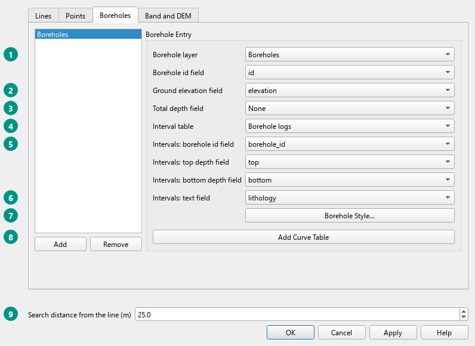

# Boreholes and logs

How to get borehole data onto your sections and into the borehole viewer.

The plugin reads boreholes from ordinary QGIS layers. You set those up once per project in **Context Layers…**. There is no import dialog yet: you bring the data in with QGIS's own tools, as shown below. What the tables must contain is in [Borehole tables](../formats/borehole-tables.md).

## Into QGIS, step by step

1. **Open the Excel file:** Layer → Add Layer → Add Vector Layer…, then choose the `.xlsx` file.
   - QGIS asks which sheets to add: add each one you need.
   - The first row is used as column names.
   - Columns that contain only whole numbers come in as integers, and that's fine.
2. **Check the columns:** right-click the layer → Open Attribute Table.
   - Numbers should be right-aligned.
   - Numbers that show as text usually mean a cell in that column holds text: a unit, a dash or a note.
3. **Make the collar points:** Processing Toolbox → search "points layer from table" (**Create points layer from table**).
   - Input: the collars sheet.
   - X field: `x`, Y field: `y`.
   - Target CRS: the coordinate system of those coordinates.
   - Save to a file, e.g. `collars.gpkg` (recommended), so the points stay when the Excel file changes.
4. **Optional: save the tables as GeoPackage too.** Right-click → Export → Save Features As…, then GeoPackage. Recommended if the Excel file is still being edited, or if it comes from a network drive.

**CSV instead of Excel:** use Layer → Add Layer → **Add Delimited Text Layer…**.

- Set the delimiter, and tick **Decimal separator is comma** for German CSV files (`0,4`). A decimal comma that QGIS doesn't know about makes the plugin skip that row.
- Choose "No geometry" for the layer and curve tables. For collars, it can make the points straight away from the X and Y columns.

## Context Layers…: field by field

**Groundwork** menu → **Context Layers…** → **Boreholes**. Each borehole entry is one set of collars with its tables. Use **Add** under the list on the left for a second set, e.g. state boreholes next to your own.

| | Field in the dialog | What to choose |
|---|---|---|
| ① | Borehole layer, Borehole id field | your collar points, and `id` |
| ② | Ground elevation field | `elevation` (or None: then the DEM or the surface line gives the height) |
| ③ | Total depth field | `total_depth` (optional) |
| ④ | Interval table | your layer table |
| ⑤ | Intervals: borehole id / top / bottom field | `id`, `top`, `bottom` |
| ⑥ | Intervals: text field | `lithology` |
| ⑦ | Borehole Style… | how the intervals look (see [Styling](#styling)) |
| ⑧ | Add Curve Table | the curve table, its id and depth fields; tick each curve and give its unit |
| ⑨ | Search distance from the line | points and boreholes this close to the profile line are drawn on the section |

Press **Apply** or **OK**. The section redraws with the boreholes as columns.

**The borehole viewer** shows the boreholes of the profile open in the section panel side by side. Open it with **Groundwork › Show Borehole Viewer**, or click a column in the section (that borehole is then framed).

**How they look is set in the borehole viewer**, and the section follows:

- **Layer text** and the ticked **Curves** in the viewer's side panel are drawn on the section too.
- So are the **column width** and **opacity** under "On the section".
- These settings apply to **every** borehole entry at once (e.g. your cores and the state boreholes).

## Styling

- **Borehole Style…**, in Context Layers… or in the borehole viewer, opens QGIS's own style editor.
  - **Categorized** on `lithology`, then **Classify**, gives one class per value.
  - **Patterns…** (button in the same window) gives every class a colour and an FGDC lithology pattern in one table.
    - Type in a pattern box to search, e.g. "sand" or "607".
    - OK hands the result to QGIS's editor as ordinary symbols: a colour fill with the pattern on top.
  - You can also set any class by hand: double-click it, then pick a colour or an **SVG fill**.
    - The FGDC patterns are listed among the SVG fills, named by code and name, e.g. "607 Massive sand or sandstone".
    - Codes 601–686 are sediments, 701–733 metamorphic and igneous rocks.
  - **Export… / Import…** save the style as a `.qml` file for the next project.
  - **Ready-made styles:** Import… opens in the plugin's own styles folder.
    - `din_codes.qml`: German short codes G, S, fS, U, T, H, Mu, A …
    - `iso_14688.qml`: EN ISO 14688-1 symbols Gr, Sa, Si, Cl, Or …

    Both are Categorized on a column `lithology`; switch to your column after importing. Their colours and patterns are the plugin's choice, not a standard's drawing rules.

  - **A class only applies to values that are exactly that code** ("fS, ms, u'" is not "fS"). To style by the main component, add a column in QGIS's field calculator with `trim(regexp_substr("lithology", '^[^,;]+'))` and style by that column.
- **Curve style…** in the viewer sets each curve's colour, line, fill, and linear or log scale with min/max.
- **Leaving a borehole out of one section**: right-click its column in the section → **Hide in Section**. It leaves that profile's section and plates only; the map, other profiles and your layer are not changed. The borehole viewer still shows it, faded and marked "hidden in section". There, click a column to select it (Ctrl+click for several) and right-click → **Hide in Section** or **Show in Section**. **Show › Hidden boreholes** switches the hidden ones off in the viewer. A borehole whose id field is empty cannot be hidden on its own.
- Without a saved style, each layer text gets its own neutral colour. The plugin never guesses a colour from the words.

If something doesn't show, see [Troubleshooting](../troubleshooting.md#when-boreholes-dont-show).

*These steps are checked by the plugin's tests on the templates* (`tests/docs/test_borehole_guide.py`).
