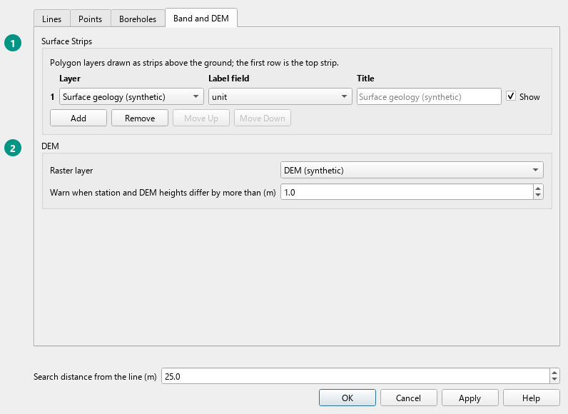
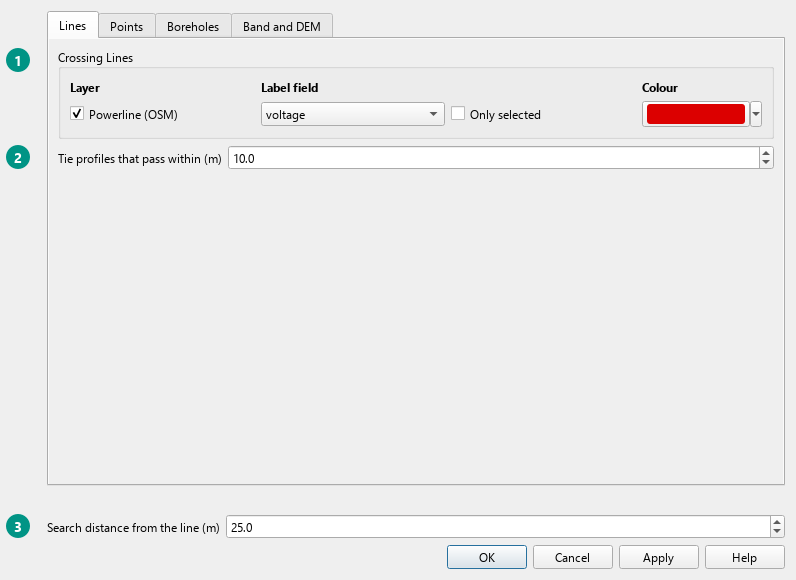
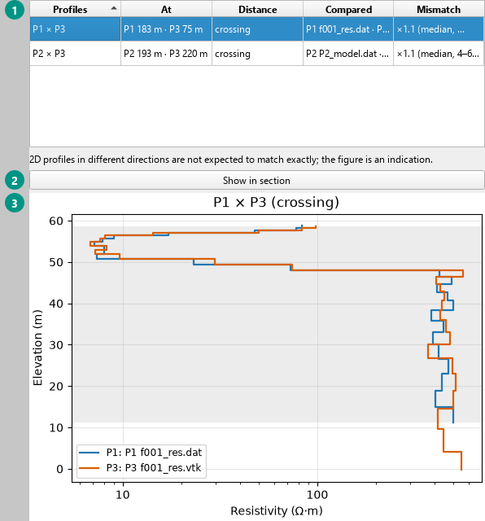

# Geology, crossing lines and ties

How to put the context of a profile on its section: geology maps as strips above the ground,
points and wells near the line, other lines that cross it, and the elevation model.

All of it comes from ordinary QGIS layers in your project. You choose them once per project in
**Groundwork → Context Layers…**; every section uses them. Press **Apply** to see a change
on the open section, **OK** to keep it and close.

Boreholes have their own page: [Boreholes and logs](boreholes.md).

## Geology strips

**Context Layers… → Band and DEM → Surface Strips** lists polygon layers drawn as strips over
the ground of the section, for example a detailed and a regional geology map.

| | Part | What it sets |
|---|---|---|
| ① | **Surface Strips** | the polygon layers drawn as strips above the ground (below) |
| ② | **DEM** | the elevation model and when heights are flagged ([below](#the-elevation-model-dem)) |

1. **Add** a row and choose the **Layer**.
2. Choose the **Label field** that names its units, for example `kennung`.
3. Type a **Title**; empty uses the layer's name.
4. **Show** switches the strip on or off. **Move Up** and **Move Down** set the order: the first
   row is the top strip.

Along a profile only the strips that have polygons there are drawn, without gaps.

The colours come from the layer's QGIS style: style it, for example **Categorized** by the
unit field, and the strips follow at once. With a plain single symbol, each unit gets a colour
of its own, the same on every profile.

## The elevation model (DEM)

**Context Layers… → Band and DEM → DEM**:

- **Raster layer**: the elevation model. The section draws its line along the profile, and
  **Topography → DEM** in the [section panel](section-panel.md#the-ground-line-topography)
  hangs the depth models from it.
- **Warn when station and DEM heights differ by more than (m)**: boreholes and stations whose
  height differs more from the DEM are marked with a small red triangle.

## Points near the line

**Context Layers… → Points → Points Near the Line**: tick point layers, for example wells,
soundings or samples. Points within the **Search distance from the line** show on the
section at their place along the profile, with:

- **Label field**: the text next to the point;
- **Depth field**: draws the point as a stick down to that depth (m).

## Crossing lines

**Context Layers… → Lines → Crossing Lines** lists line layers: roads, rivers, faults, pipes,
other surveys. Where a ticked layer's lines cross the profile, the section shows a vertical
line with its label.

| | Part | What it sets |
|---|---|---|
| ① | **Crossing Lines** | per line layer: the tick, **Label field** (the text on the section), **Only selected** (only the features selected on the map) and **Colour** |
| ② | **Tie profiles that pass within (m)** | how near two profiles must pass to be tied ([below](#ties-with-other-profiles)) |
| ③ | **Search distance from the line (m)** | how near points and boreholes must be to show on the section; for every tab |

## Ties with other profiles

Where two profiles cross, or pass within **Tie profiles that pass within (m)** (**Context
Layers… → Lines**), each section shows a strip at the tie with the other profile's name.
The other profile's [interpretation](interpretation.md#where-profiles-cross) shows there too.

**Groundwork → Profile Ties…** opens a panel with every tie:

| | Part | What it shows |
|---|---|---|
| ① | The table | **Profiles**, where along them (**At**), how far apart they pass (**Distance**), which models are **Compared** and their **Mismatch** |
| ② | **Show in section** | opens the first profile at the tie |
| ③ | The plot | both model columns at the selected tie, against elevation |

The mismatch is a hint for comparing by eye: two 2D models along different directions are not
expected to match exactly.

A local section (a profile without heights) has no ties until it has a
[reference height](reference-height.md).
