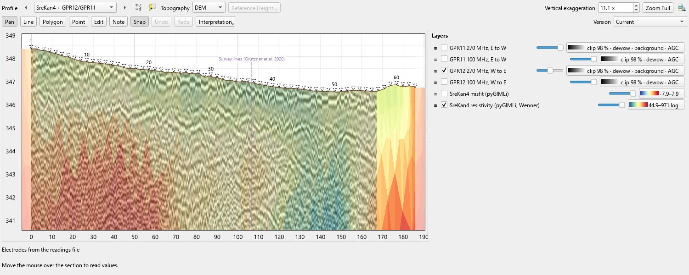
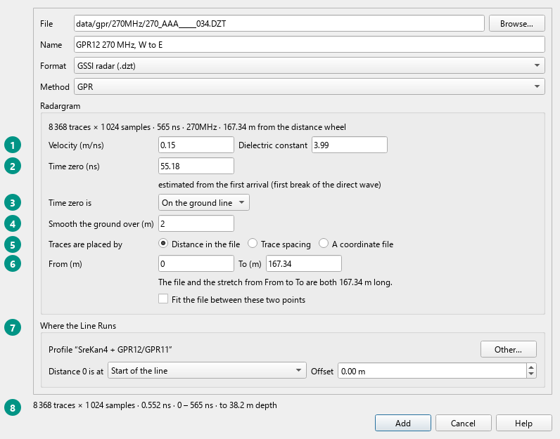
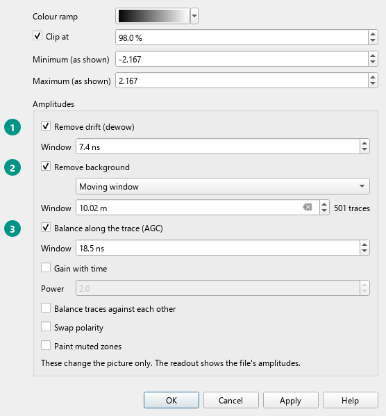
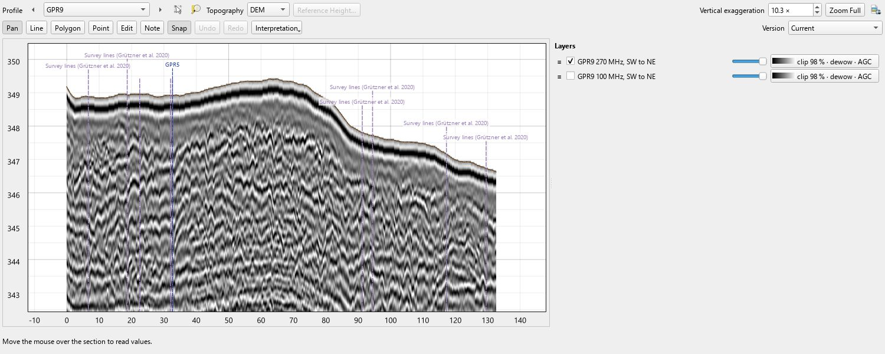
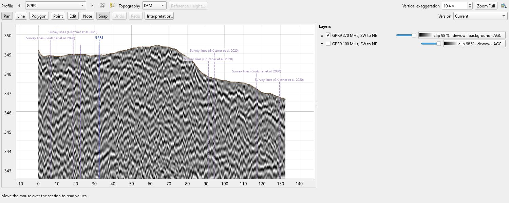
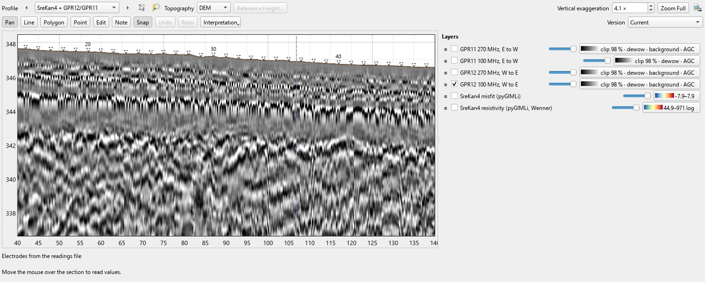
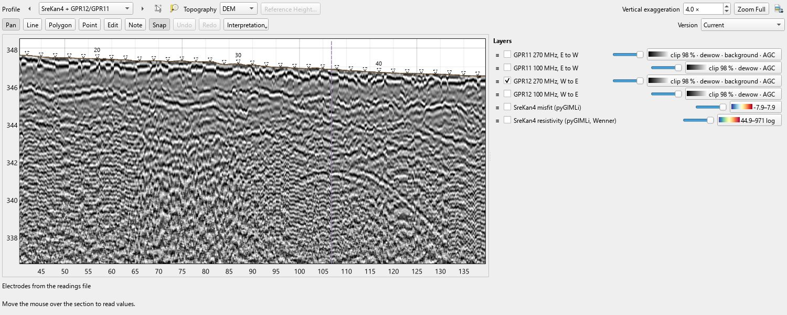

# Ground-penetrating radar

A radargram comes in from the radar's own file and hangs from the profile's ground line, in
depth, next to resistivity models, seismic sections, boreholes and geology. You read it and
draw on it with the same tools as on any other section.

*A 270 MHz radargram over the resistivity model of the same line, the top 8 m.
Data: Grützner et al. 2020, PANGAEA, CC BY 4.0. Terrain: ARSO (Slovenian Environment Agency).*

## What a radargram is in Groundwork

A radar file holds one trace per position along the line: the echo of the radar pulse, sample
by sample, over a few hundred nanoseconds. Groundwork turns the time into depth with a radar
velocity you choose, puts time zero on the ground and places the traces along the profile by
the distances in the file. The section shows the file's amplitudes in grey. What you see under
the mouse is the file's own number, with the trace, the time after time zero in ns and the
depth below the ground.

- The data are never changed. The display options below change only the picture.
- Groundwork reads two formats itself, without an extra library: GSSI `.DZT` and
  Sensors & Software pulseEKKO `.DT1` with its `.HD`. See [What is covered](#what-is-covered).
- Radar exported as SEG-Y also loads, as a [reflection section](reflection-sections.md).

## Add a radargram

**Groundwork → Add Data…** and choose the `.DZT` file, or the `.DT1` or `.HD` file of a
pulseEKKO line. The dialog reads the header and shows the **Radargram** part; **Method** is
**GPR**. The line at the top of the part says what the file holds: traces, samples, the time
window, the antenna, and the length from the distance wheel.

| | Part | What you check |
|---|---|---|
| ① | [Velocity](#velocity-and-dielectric-constant) | The radar velocity in m/ns, or the dielectric constant: either fills the other |
| ② | [Time zero](#time-zero) | Where in the trace the pulse leaves the ground surface, in ns |
| ③ | [Time zero is](#time-zero) | On the ground line (the usual case), or at a fixed height |
| ④ | [Smooth the ground over](#smoothing-the-ground) | The length the ground under the radargram is averaged over |
| ⑤ | [Traces are placed by](#distance-from-the-wheel) | The distances in the file, a trace spacing, or a coordinate file |
| ⑥ | [From and To](#fitting-a-file-between-two-points) | Where the first and the last trace lie along the profile |
| ⑦ | [Where the Line Runs](add-data.md#where-the-line-runs) | The profile, where distance 0 is, and an offset |
| ⑧ | [The check result](add-data.md#the-check-result) | Traces, samples, time window and the depth reached |

*Data: Grützner et al. 2020, PANGAEA, CC BY 4.0.*

1. Type the velocity under ①, or the dielectric constant. Groundwork assumes none.
2. Check time zero under ②. Leave ③ on **On the ground line**.
3. Under ⑦ choose the profile and where distance 0 of the file is: the start or the end of the
   line, and an offset.
4. Read ⑧, then press **Add**.

To add several radar files at once, choose them together in **Browse…**. The **Files** table
then has a **Time zero** column: each file gets its own, from its header or estimated from its
own traces. The velocity is the same for all. See
[Several files at once](add-data.md#c-several-files-at-once).

## Velocity and dielectric constant

Depth is velocity × (time − time zero) ÷ 2. The velocity is the speed of the radar wave in the
ground. Type it in m/ns, or type the relative dielectric constant ε: the velocity is
0.2998 m/ns ÷ √ε. The other field follows.

Groundwork never assumes a velocity:

- A pulseEKKO file states none: the field is empty and must be filled.
- A GSSI header holds a dielectric constant. Groundwork shows it, marked *from the file's
  header (an instrument setting; check it)*. It is what the instrument was set to in the
  field, not a measurement.

Where a good value comes from, best first:

- a reflector at a known depth: a borehole, a pipe, a trench, the water table;
- the processing report of the survey, or the velocity the authors used for their depth
  axis;
- a velocity analysis in radar software: hyperbolas from small objects, or a CMP survey;
- a table, as a first guess: about 0.15 m/ns in dry sand, 0.06 m/ns in wet sand or clay,
  0.10–0.12 m/ns in many rocks.

What a wrong value does: every depth is off by the same factor. A velocity 10 % too high puts
every reflector 10 % too deep. On the pictures of this page the authors' 0.15 m/ns is used;
the files' headers say ε 18, which is 0.071 m/ns. With the header's value every reflector would
be drawn at less than half its depth.

The plate's line under the section states the velocity used, for example *GPR · radargram ·
depth from v = 0.15 m/ns (ε 4.0)*. You can change the velocity later in
[Dataset info](dataset-info.md): the picture moves, nothing is read again. Drawings stay at
their heights; Groundwork asks before it moves a radargram on a profile with drawings.

## Time zero

The pulse does not leave the antenna at the first sample: each trace starts with some
nanoseconds of air before the direct wave arrives. **Time zero (ns)** is the time that lies on
the ground. Samples before it are above the ground and are not drawn.

- A pulseEKKO header states it (*TIMEZERO AT POINT*); it is marked *from the file*.
- A GSSI file does not. Groundwork proposes the first arrival of the average trace, marked
  *estimated from the first arrival (first break of the direct wave)*. Look at it and change
  it when you know better.
- A time zero too late lifts every reflector by the difference times half the velocity:
  2 ns too late at 0.1 m/ns puts everything 10 cm too high.

**Time zero is** says where it hangs: **On the ground line** (the usual case, the radargram
follows the terrain) or **At a fixed height** that you type. On a profile without heights the
radargram is a local section in depth below its top; Add Data says so.

### Smoothing the ground

The ground line comes from the profile's stations or its elevation model. The steps of an
elevation model would show in a radargram hung on it as vertical seams, every metre or so.
**Smooth the ground over (m)** averages the ground under the radargram over this length along
the profile before hanging it: 2 m for a new radargram. 0 hangs it on the ground as sampled.
The ground line itself is drawn as it is.

## Distance from the wheel

A survey wheel measures the distance along the ground, and the file stores it: GSSI as scans
per metre, pulseEKKO as a position per trace. **Distance in the file** uses it. Files recorded
by time, without a wheel, say so; choose **Trace spacing** and type the distance between two
traces. **A coordinate file** (trace number, easting, northing) works as for
[SEG-Y](reflection-sections.md#where-the-traces-lie).

Under ⑦, **Distance 0 is at** the start or the end of the line, with an **Offset**. A file
walked against the profile's direction starts at the end: its traces then run back along the
profile.

### Fitting a file between two points

**From (m)** and **To (m)** show where the placement puts the file's first and last trace
along the profile. The line below compares the lengths, for example *The file is 125.78 m
long, the stretch from From to To 111.30 m (11.5 % shorter).*

- Type other values to move the file: From is where its first trace lies. To smaller than From
  runs it against the profile's direction.
- Tick **Fit the file between these two points** to stretch the file's distances evenly so
  that its first trace lies at From and its last at To.

Fit only when both points are better than the wheel. A wheel measures along the ground, so a
file is a little longer than the straight line on a slope, by a few per cent. The ends of a
line taken with a handheld GPS can be several metres off, which is often worse than the
wheel's error. Fitting to such ends stretches every trace by that error. When in doubt, place
the file by its start and leave the tick off.

## Display options

Right-click the radargram in the panel's **Layers** list → **Display…**. A new radargram
starts with a look chosen on real lines, so that reflections show without opening this dialog.

| | Option | What it does | At the start |
|---|---|---|---|
| ① | Remove drift (dewow) | Takes away the slow drift of each trace, a running mean over the window | On, over two periods of the antenna's frequency |
| ② | Remove background | Takes away what is the same in every trace: the antenna's ringing, the direct wave. **Whole line** subtracts the mean trace of the line, **Moving window** the mean of the traces around each one, typed in metres | On, a moving window of 10 m |
| ③ | Balance along the trace (AGC) | Evens out the amplitudes down each trace, so weak deep reflections show | On, over five periods of the antenna's frequency |

*Data: Grützner et al. 2020, PANGAEA, CC BY 4.0.*

The colour ramp, **Clip at**, **Gain with time**, **Balance traces against each other**,
**Swap polarity** and **Paint muted zones** work as for a
[reflection section](reflection-sections.md#display-options). The options change the picture
only; the readout keeps showing the file's amplitudes.

### Why the background is removed over 10 m

Most antennas ring: the same wiggle in every trace, which shows as flat bands parallel to the
ground, often down to the end of the record. They look like layers and are not.

*Line GPR9, 270 MHz, the upper 6 to 8 m: above with dewow and AGC only, below with the
background removed over 10 m as well. Data: Grützner et al. 2020, PANGAEA, CC BY 4.0.*

The ringing of a real antenna changes along the line, in stretches of some metres. A moving
window of 10 m follows it and removes it; the mean of the whole line does not. Dipping
reflectors and the hyperbolas of small objects stay, because they differ from trace to trace.

The cost: anything flat that runs much longer than 10 m is removed too. A flat layer, or a
water table, tens of metres long fades. When you look for one, choose **Whole line** in
**Remove background**, or untick it: one click in **Display…**. **Apply Style to All Sections**
in the same menu gives the other radargrams the same look.

## Two antennas on one line

Many surveys run a line twice, with a low and a high frequency antenna. Add each file to the
same profile: they are two layers, named after the file and its antenna, such as
*270_AAA_____034 (270MHz)*. A clearer **Name** in Add Data, such as *GPR12 270 MHz*, helps
later. Tick one at a time in **Layers**, or lay one over
the other with the opacity slider.

*Line GPR12 along SreKan4, 40 to 140 m, the top 12 m: above at 100 MHz, below at 270 MHz.
Data: Grützner et al. 2020, PANGAEA, CC BY 4.0.*

The low frequency reaches deeper with coarser detail; the high frequency shows finer detail
near the surface and fades sooner. The same velocity and the same placement for both keep them
comparable.

## In Dataset info, on plates and in 3D

- **[Dataset info](dataset-info.md)** shows the antenna, the number of traces and samples and
  the time window, and edits the velocity (or dielectric constant), time zero, where time zero
  lies and the smoothing of the ground.
- **[Report plates](plates.md)** draw the radargram in its frame with a small *Amplitude* key,
  and the line under the section states the velocity.
- **[The 3D view](3d-view.md)** shows a radargram as a section picture under its profile.
- **Interpretation**: draw reflectors and objects with the
  [interpretation tools](interpretation.md), as on any section.

## What is covered

Groundwork reads these files itself. Anything else is refused with a message that names the
file and says why; it never guesses a layout.

| Format | Covered | Refused |
|---|---|---|
| GSSI `.DZT` | One channel, 8-, 16- or 32-bit samples; distance from the file's scans per metre, or a trace spacing for files recorded by time | Files with several channels, other sample sizes, a header without samples or time range, fewer than two whole scans |
| pulseEKKO `.DT1` + `.HD` | The pair of files with the same name (choose either); 2-byte samples; positions in metres; time zero from the header | A missing partner file, a header without traces, points or time window, other sample sizes, positions in other units |

Good to know:

- GSSI stores 8- and 16-bit samples as unsigned numbers. Groundwork subtracts the middle value
  (128 or 32,768), so the amplitudes swing around zero. Nothing else is done to them.
- The first two samples of each GSSI scan are a scan counter and marks, not radar data. They
  lie before time zero.
- Not read: GPS files beside GSSI files (`.DZG`), the GPS fields of pulseEKKO traces, marks,
  and other makers' formats (MALÅ `.rd3`/`.rd7`, IDS, ImpulseRadar, 3D-Radar). Export these as
  SEG-Y to load them as a reflection section.
- No processing: no migration, no frequency filters, no velocity analysis. The display options
  change only the picture.
- One velocity per radargram.

The readers were checked against 150 real GSSI files (16-bit, 100, 270 and 400 MHz) and four
pulseEKKO lines (250 MHz) of the dataset the pictures come from: Grützner, C. et al. (2020):
Geophysical survey (GPR, ERT, magnetic) on active faults in Slovenia and Italy. PANGAEA,
<https://doi.org/10.1594/PANGAEA.922902>, CC BY 4.0. The resistivity models in the pictures
were inverted with pyGIMLi from the authors' readings for these pictures; they are not the
authors' results.
