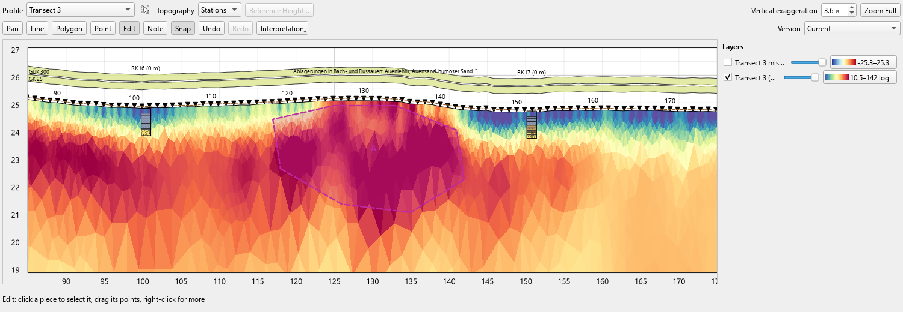

# Interpretation

How to draw layer boundaries, bodies and picks on a section, name them, keep versions and
take them to the map, to 3D and to other programs.

Everything you draw is GIS data from the first click: each point gets its real easting,
northing and elevation along the profile, also where the profile bends. It is kept in your
Groundwork file and shows on the map, on plates and in the 3D view.

Interpretation belongs to one profile. A piece you draw on one profile never joins a feature
on another one.

## Drawing

The tools sit in a row above the section:

| Tool | What it draws |
|---|---|
| **Pan** | nothing: move and zoom the section, click for details |
| **Line** | a layer boundary, a fault, a water table |
| **Polygon** | a body, an anomaly, a zone you don't trust |
| **Point** | a pick, a depth |
| **Edit** | changes what is drawn (see [Editing](#editing)) |
| **Note** | a [field note](field-notes.md) |
| **Snap** | on or off (see [Snapping](#snapping)) |
| **Undo**, **Redo** | every drawing and editing step |

1. Choose **Line**, **Polygon** or **Point**.
2. Click to add points. **Backspace** takes the last one back.
3. **Right-click**, double-click or press **Enter** to finish. A point is finished with its
   one click.
4. The **Interpretation** form asks for:
   - **Type**: any text, for example *clay* or *conductive body*. The list suggests the types
     already used.
   - **Name**: any text, for example *Clay A*. It is drawn as the label on the section. You
     are told if another feature on the profile has the same name, but it is allowed.
   - **Confidence**: certain, probable or uncertain, or nothing.
   - **Note**.

   Every field may stay empty: draw first, decide later.

While you draw:

- drag with the **middle mouse button** to pan, also in the middle of a shape; the wheel zooms;
- **Esc** clears what you started; a second **Esc** goes back to **Pan**;
- a point above the ground line is put down on the ground.

The first piece you draw on a profile adds the interpretation layers to the project (see
[On the map and in 3D](#on-the-map-and-in-3d)).

### Snapping

With **Snap** on (the default), a point you click or drag snaps to the first of these within
reach:

1. the points of anything already drawn on the profile;
2. the layer boundaries of the boreholes on the section;
3. the edge of the coverage fade, when the model's [display](section-panel.md#how-a-model-is-drawn)
   fades low coverage;
4. the ground line.

## Editing

Choose **Edit**:

- click a piece to select it;
- drag one of its points to move it;
- click an edge of the selected piece to add a point there, and drag it;
- drag inside a polygon, or **Shift**-drag a line, to move the whole piece;
- **Delete** removes the selected point, or the whole piece after asking;
- double-click opens the form with its type, name, confidence and note;
- **Esc** deselects, a second **Esc** goes back to **Pan**.

Right-click a piece for more:

- **Attributes…**: the form.
- **Move piece to**: another feature of the profile, or **New feature**, which splits the
  piece off with the same type, confidence and note and no name.
- **Merge this feature into**: all pieces of this feature join another one.
- **Delete piece**.

A feature can have several pieces: a clay layer cut in two by a channel is one feature with
two polygons. **Undo** and **Redo** cover every step while the profile is open.

## Types

**Interpretation → Types…** lists the types in use with how many features have each.
**Rename…** changes a type in every feature of the version you work on. Giving it the name of
another type (in any spelling of upper and lower case) merges the two.

## Versions

Before a report, keep what you have, and carry on working:

- **Interpretation → Freeze…** keeps the current interpretation as a named version, for
  example *Report 1*. A frozen version cannot be changed.
- The **Version** list at the end of the row shows a frozen version. Its box is tinted and
  the tools are off while you look at it. Choose **Current** to go back.
- **Interpretation → Start from This Version** makes the frozen version you are looking at
  the current one. It offers to freeze your present work first.
- **Interpretation → Compare With** draws a frozen version faintly behind the current one.

## Details on a click

With **Pan**, click a piece for all its attributes, including [your own fields](#your-own-fields).
Where a borehole column lies under it too, the details offer **Open in borehole viewer**.

## On the map and in 3D

The project's Groundwork group gets a group **Interpretation** with:

| Layer | What it holds |
|---|---|
| **Interpretation features (attributes)** | one row per feature: type, name, confidence, note and your own fields |
| **Interpretation polygons (3D)**, **lines (3D)**, **points (3D)** | the pieces, in real coordinates with elevation |
| **Interpretation footprints** | where each piece lies along the profile on the map, labelled with its name |

The 3D and footprint layers are made from what you draw and are rebuilt after every change:
edit on the section, not in these layers.

### Style

Each feature has its own legend entry and colour. Confidence is the line style: solid for
certain, dashed for probable, dotted for uncertain. The section draws with the layers' QGIS
style, so restyle a layer in **Layer Properties → Symbology** and the section follows at once.
In the [3D view](3d-view.md#stations-and-the-interpretation-in-3d) the pieces take the same
colours and outlines.

### Your own fields

Open the attribute table of **Interpretation features (attributes)** and add a field, for
example *drill target*. Fill it in the attribute table or with the field calculator. The 3D
layers and the details on a click show it.

### Where profiles cross

Where another profile crosses, its interpretation shows at the crossing, with its name:
polygons as see-through bars, lines as ticks, points as diamonds.

## Export

**Interpretation → Export…** writes the pieces in 3D:

- in **Edit** with a piece selected, the pieces of that feature;
- otherwise every feature of the version shown.

**GeoPackage** (`.gpkg`) gets one layer each for lines, polygons and points, with the
attributes. **DXF** (`.dxf`) puts every piece on a layer named after its feature, for example
*A - resistive body*; DXF layer names are plain ASCII, so ä, ö, ü and ß become ae, oe, ue and
ss.

A local section (a profile without heights) has no real elevations, so it is left out of the
export. Give it a [reference height](reference-height.md) first.

## Try it

In the Gülpe demo, open **Transect 3**:

1. Choose **Polygon** and draw around the high-resistivity body between about 117 and 142 m
   (red). Call the type *resistive body* and the name *A*.
2. Choose **Edit**, drag one corner, then press **Undo**.
3. **Interpretation → Freeze…** and call it *Test*. Move a corner again.
4. **Interpretation → Compare With → Test**: the old shape shows faintly behind.
5. Look at the map: the footprint along the transect is labelled *A*.
