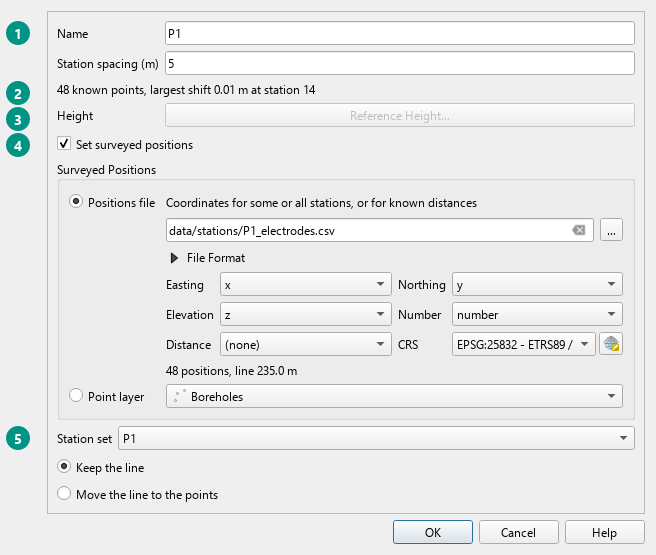

# Placement on the electrodes

How Groundwork decides where along the line a model sits: surveyed positions, known points and the fit report, and the electrodes it shows when none were imported.

## Adding surveyed positions later

Open the profile in the section panel and choose **Profile Properties…**.

| | Part | What it is for |
|---|---|---|
| ① | Name and Station spacing | The profile's name, and the stated distance between stations (empty clears it) |
| ② | Fit report | How the model sits on the known points with the spacing and positions as you edit them, before anything is saved (see [below](#known-points-and-the-fit-report)) |
| ③ | Reference Height… | Real heights for a local section; greyed for a profile that has real heights (see [Reference height](reference-height.md)) |
| ④ | Set surveyed positions | Tick it, then choose a positions file or a point layer; nothing changes while it is off |
| ⑤ | Station set, and the line | The station set the positions replace (or **New set**), and whether the line stays or moves |

1. Tick ④ **Set surveyed positions** and choose a positions file or a point layer.
2. Under ⑤ choose the station set they replace (or a new set).
3. Choose **Keep the line** or **Move the line to the points**.
   - Keep: the points are projected onto the line; points more than 5 m off are listed first.
   - Move: the dialog asks first and names what moves.
4. Read ② the fit report, then **OK**. Everything is saved together, or not at all.

When the line moves:

- field notes and the current interpretation follow by map position;
- frozen interpretation versions keep their stored positions;
- the models keep their place on the map;
- what lies past the ends of the old line (interpretation drawn over a model's padding, a note range) keeps its distance beyond the ends of the new one.

Profile Properties… replaces Rename Profile….

## Known points and the fit report

A **known point** is a surveyed position whose distance in the model file is known. A station gets its distance from the first of these that has one:

1. a distance column (stored with the station);
2. the electrode list of a readings file (e.g. a BERT `.data` file): station *n* is electrode *n*;
3. a **station spacing** you typed in Profile Properties: station number × spacing;
4. a spacing guessed from the model (see [below](#electrodes-you-did-not-import)), used only when it fits.

With two or more known points the model sits at the real positions and is stretched evenly in between; outside them it continues one metre per metre.

The **fit report** says how far the file's distances and the surveyed positions disagree, for example:

> 5 known points, largest shift 1.6 m at station 16

A shift larger than half the gap between known points is shown in the warning colour and followed by *Check the station spacing or the station numbers.*: the file and the survey probably do not belong together, or the spacing is wrong. Add Data shows the report in its result block, Profile Properties under the station spacing.

- A typed spacing is stored with the profile. A guessed one never is.
- A guess that does not fit is not used. The profile then says *Known points not used: the station spacing guessed from the model does not fit them; type the station spacing in Profile Properties*.
- Stations numbered out of order along the line are named the same way.
- Stations that an older version invented from a spacing on a drawn line (no heights, exactly on the line, evenly spaced) are never known points. They stay as they are.

## Electrodes you did not import

When a profile has no stored stations, the section still shows where the electrodes are, from the best source there is:

| Kind | Where it comes from |
|---|---|
| **imported** | stored stations (a positions file, a point layer) |
| **from the readings file** | the electrode list of the measured data |
| **from spacing** | the station spacing you typed |
| **guessed** | the model's top edge, only for models given as rows or columns of cells |

A triangulated mesh, such as the pyGIMLi VTK results, gives no guess: its surface nodes are three to four times denser than the electrodes and reach past the line ends. A profile with only such a model and no positions says *No electrode positions: import them or type the spacing in Profile Properties*.

Derived electrodes are **never stored**. They show

- on the map as the temporary layer **electrodes (derived)**, in the Groundwork group. Style it like any layer; your style is kept with the QGIS project. If you remove it, it comes back the next time the project is opened;
- in the section as dashed ticks.

A line under the section says which kind is shown, any placement note, and for a local section *Local section: no heights yet, values are depth below the surface*.

Field notes by electrode number work on derived electrodes too; their label says "(guessed)" or "(from spacing)".

A guess is a guess. In the small demo models the cells are half an electrode spacing wide, so the guessed spacing comes out as half the real one (see the [0.9.0 release notes](../../releases/0.9.0.md)). Type the spacing when you know it.
