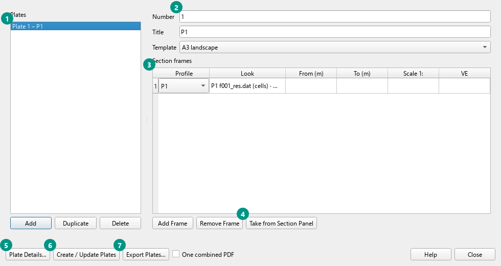
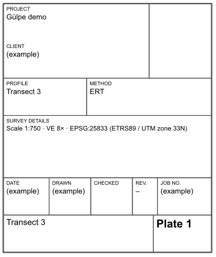

# Report plates

How to turn sections into report plates (PDF) in the QGIS layout.

## Making plates

Open **Groundwork → Plates…**.

| | Part | What you do there |
|---|---|---|
| ① | Plates | **Add** a plate; it starts with one frame showing the profile and look of the section panel |
| ② | Number, Title, Template | Name the plate and choose its page |
| ③ | Section frames | One row per section on the plate, stacked top to bottom |
| ④ | Take from Section Panel | Copy the panel's profile and look into the selected frame |
| ⑤ | Plate Details… | The title block's texts and logo, once per project |
| ⑥ | Create / Update Plates | Make the layouts |
| ⑦ | Export Plates… | Write the PDFs |

The parts in the order you use them:

- ② **Template**: A4 or A3, portrait or landscape. You can also choose **Own template…** (see [Plate templates](../formats/plate-templates.md)).
  Choosing another template for a plate that already has a layout makes the layout again,
  after asking: changes made to it in QGIS's layout designer are lost.
- ③ **Section frames**: each row is a profile with its own look. To show the ERT model and the seismics of the same line, add two rows with the same profile.
  - **From / To** limit the chainage range. Leave them empty for the full data range.
  - **Scale / VE** fix the scale (e.g. 2500 for 1:2500) or the vertical exaggeration. Leave them empty to fit the page.
- ④ **Take from Section Panel**: the look covers which models are shown, their colour scale, display mode and opacity, the interpretation version, and whether boreholes, field notes and context are shown. Restyling the panel later does not change the plate.
- ⑤ **Plate Details…** sets project, client, job number, date, drawn (author), checked and revision, and a **logo** (an image file; **Clear** removes it).
  - They are entered once per project and shown on every plate.
  - A logo inside the project's folder is stored relative to it, so the folder can move; a logo that cannot be found leaves its cell empty.
- ⑥ **Create / Update Plates** makes the layouts. They are ordinary QGIS print layouts, named e.g. "Plate 1 – Transect 3", and you open them from QGIS's Layout Manager.
- ⑦ **Export Plates…** updates every plate and writes one vector PDF per plate (`Plate_1_Transect_3.pdf`) into a folder you choose. Tick **One combined PDF** to get all pages in one file instead.

### Fit to page

- The **horizontal scale** is the largest standard scale (1:100, 1:125, 1:150, 1:200, 1:250, 1:300, 1:400, 1:500, 1:750, 1:1000, 1:1250, 1:1500, 1:2000, 1:2500, 1:3000, 1:4000, 1:5000, 1:7500, 1:10000 … 1:50000) at which the frame's range fits its width and its depth fits the height.
- The **VE** is the largest standard value (1, 1.25, 1.5, 2, 2.5, 3, 4, 5, 6, 8, 10, 15, 20) at which the depth range fits the frame's height. Room for the labels above the ground is kept.
- A frame that does not fit even at 1:50000 says so in its provenance line, and **Create / Update Plates** says so too. Set a From/To range or a scale.
- **Frames of the same profile** share scale, range and VE, so features line up vertically.
- The provenance line under each frame states the scale and the VE ("1:2500 · VE 2×"), plus the start and end coordinates of the profile.

### What updating keeps

Running **Create / Update Plates** or **Export Plates…** again refreshes only the plugin's own content:

- the sections;
- the colour bars;
- the contents of the legends;
- the field-notes list;
- the title block;
- the section titles;
- the provenance lines.

Texts you edited in the layout designer stay as you wrote them: every text of the title block (values and captions), the field-notes list, section titles and provenance lines. A title-block cell you deleted stays deleted. If you edited the field-notes list and the notes change later, the message after Update says so; delete the label's text and update again to get the new list.

Anything you moved, resized, restyled or added in the layout designer stays as it is. One exception: when a plate gets more or fewer frames, the frames and their colour bars are laid out in the section area again.

Deleting a plate in the dialog keeps its layout. Delete the layout in the Layout Manager if you no longer need it.

If a plate's profile was removed from the project, its frame says "Profile not found". The plate can still be exported.

## What is on a plate

- **Section frames**: QGIS's own elevation-profile layout items, drawing the same section as the panel, with distance and elevation axes in metres.
- **Section titles**: the profile's name at the top of each frame. Edit or move it in the layout designer; Update keeps your change. Texts inside the section (labels, contour values) are styled in the section panel and the plate follows.
- **Colour bars**: one per model shown, using the frame's colour scale. Select a colour bar in the layout designer to tune it. In its panel you set:
  - ticks: `auto`, a step such as `step:25`, or a list such as `list:1,10,100,1000`;
  - title and unit;
  - QGIS's own colour-ramp legend settings: orientation, which end the minimum is at, number format, prefix/suffix and fonts.
- **Interpretation legend**: a normal QGIS legend of the interpretation layers. It lists only the entities on this plate's profiles, with their QGIS styles.
- **Borehole legend**: the classes of each borehole style that occur on the plate (colour, pattern, label), plus the log curves shown (name, unit, line). Select it to change its font.
- **Field-notes list**: the shown notes of the plate's profiles, in chainage order.
- **Mini-map**: the plate's profiles are highlighted, with a dot at the start and an arrow at the end; other profiles are faint. It has a north arrow (grid north), a bar scale and the coordinate system. It shows the project's visible map layers.
- **Title block**: see [below](#the-title-block).

## The title block

A stamp ruled into cells, as on an engineering drawing. Each cell has a small caption and its value:

- From **Plate Details…**: project, client, logo, date, drawn, checked, revision and job number.
- From the plate: the profiles, the method, the survey details, the plate's title and number. Method and survey details come from each model's **Dataset info**: method and array; acquisition date and electrode spacing; inversion software, reference and RMS. Scale, VE and the coordinate system come from the plate. A value that differs between the sections of one plate is left out of the stamp (scale and VE read "per section"); the provenance line under each section has the details. Nothing unknown is filled in.
- Every part is an ordinary layout item: restyle, move or delete it in the layout designer.
- Plates made before 0.11 keep their old title block (a list of "Label: value" lines) and keep updating it.

Set the typed values in **Plates… → Plate Details…**. They are entered once per project and shown on every plate.
