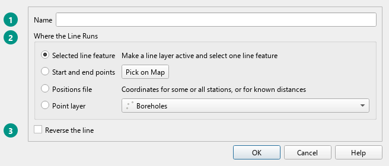

# Projects and profiles

How to start a Groundwork project, make profiles, change them and delete them.

## The Groundwork project

Groundwork keeps your profiles, stations, links to your model files, interpretation and field
notes in one GeoPackage, usually next to the QGIS project: `<project>_groundwork.gpkg`.
The QGIS project remembers it: open the QGIS project and its Groundwork project opens with it.

- **Groundwork → New Groundwork Project…**: choose the file name, then the coordinate system
  of the project. Choose a projected one in metres, for example a UTM zone. An existing file is
  never overwritten.
- **Groundwork → Open Groundwork Project…**: open an existing one in the current QGIS project.

Save the QGIS project afterwards so it remembers the Groundwork project.

Your model files are not copied into the GeoPackage: each model is a link to its file, read
again when the file changes. Keep the files where they are.

## A new profile

A profile is a line on the map with a name. Models, stations, boreholes and interpretation
belong to it.

**Groundwork → New Profile…**:

| | Part | What you choose |
|---|---|---|
| ① | **Name** | for example *ERT 3* or *Line 6* |
| ② | **Where the Line Runs** | how the line is given (below) |
| ③ | **Reverse the line** | when distance 0 is at the other end |

**Where the Line Runs**:

- **Selected line feature**: make a line layer active and select one line first;
- **Start and end points**: **Pick on Map**, then click the start and the end;
- **Positions file** or **Point layer**: the surveyed electrode or geophone positions; the line
  runs through them, and a **Method** row asks for ERT or seismic refraction (see
  [Placement on the electrodes](placement.md)).

Press **OK**: the profile shows on the map.

A profile is also made by **Add Data…** when you add a file with map coordinates, or a model on
a line you choose there (see [Add data](add-data.md)).

## Profile properties

**Groundwork → Profile Properties…**, or right-click the **Profile** list in the section panel:

- **Name**;
- **Station spacing (m)**, the stated distance between neighbouring stations;
- **Height**: **Reference Height…** for a profile without heights (see
  [Reference height](reference-height.md));
- **Surveyed Positions**: **Set surveyed positions** from a file or a point layer, with **Keep
  the line** or **Move the line to the points** (see [Placement on the
  electrodes](placement.md#adding-surveyed-positions-later)).

Everything in the dialog is saved together, or not at all.

## Deleting a profile

**Groundwork → Delete Profile…**, or right-click the **Profile** list. The question lists what
goes with it: its stations, model links, interpretation pieces and field notes. Your data files
and QGIS layers are not touched, and frozen interpretation versions keep their pieces.
