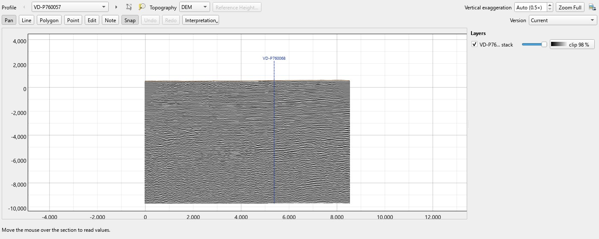
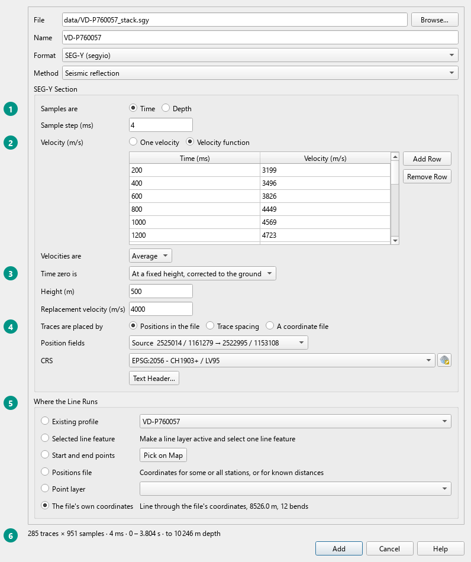
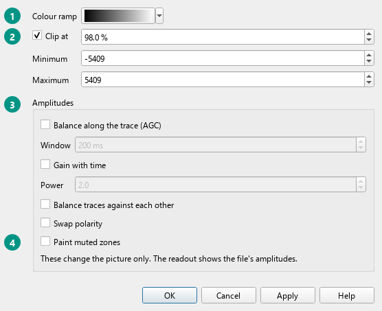
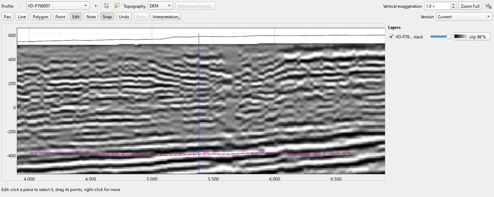

# Reflection sections

A processed seismic reflection section (a stack or a migrated section) comes in from its
SEG-Y file and stands on its profile in depth, next to the ground line, boreholes, resistivity
models and crossing lines. You pick horizons on it with the same tools as on any other section.

*The Vaud demo, line VD-P760057. Data: Federal Office of Topography swisstopo.*

## Add a SEG-Y section

**Groundwork → Add Data…** and choose the `.sgy` or `.segy` file. The dialog reads the file's
headers and shows the **SEG-Y Section** part; **Method** proposes **Seismic reflection**.

| | Part | What you check |
|---|---|---|
| ① | [Samples are](#time-or-depth) | Time or depth, and the sample step read from the file |
| ② | [Velocity](#depth-needs-a-velocity) | The velocity, or a velocity function, that turns time into depth |
| ③ | [Time zero is](#where-time-zero-lies) | Where time zero lies: on the ground line, or at a fixed height |
| ④ | [Traces are placed by](#where-the-traces-lie) | The positions in the file, a trace spacing, or a coordinate file |
| ⑤ | [Where the Line Runs](add-data.md#where-the-line-runs) | Which profile the section belongs to, or where a new one is |
| ⑥ | [The check result](add-data.md#the-check-result) | Traces, samples, time range and depth reached, and any warnings |

*Data: Federal Office of Topography swisstopo.*

1. Check ① and ②: a time section needs a velocity. The field is empty unless the file's text
   header states one; Groundwork never assumes a velocity.
2. Under ③ say where time zero lies. For a processed land line this is usually **At a fixed
   height**: the datum from the processing report.
3. Under ④ choose how the traces are placed. Files with positions in their headers propose
   them.
4. Under ⑤ choose the profile, or **The file's own coordinates** for a new one along the
   traces. Read ⑥, then press **Add**.

**Text Header…** shows the 40 lines of text at the start of the file: the processing steps,
the datum and often the velocity are written there.

### Time or depth

- **Time** (the usual case): the samples are two-way time. The **Sample step** is in ms.
- **Depth**: a depth-migrated or depth-converted section. The sample step is in metres and no
  velocity is needed. Check the step: many files have no field for metres, so the number may
  need correcting. Radar exported as SEG-Y is also a case for correcting the step.

### Where the traces lie

- **Positions in the file**: the trace headers hold map coordinates. **Position fields**
  lists the header fields whose positions change along the line (CDP, source, receiver), with
  the first and last position, so you can see which one is right. Choose their **CRS**.
  A new profile follows the traces as a line with bends, the way the processed line runs.
- **Trace spacing**: no coordinates; type the distance between two traces. See
  [Files without positions](#files-without-positions).
- **A coordinate file**: a text table beside the SEG-Y with a trace or CDP number, easting and
  northing per row. Choose the file and the three columns. Traces between listed numbers are
  placed evenly between them.

A file that looks like unstacked records (shot or CDP gathers) gets a warning: Groundwork
shows processed sections. A 3D volume is named as such and not added.

## Depth needs a velocity

Groundwork draws the section in depth. A time section is turned into depth with **one
velocity** for the whole section, or with **one velocity function**: a short table of two-way
time against velocity (typed, or pasted with Ctrl+V), with **Velocities are** average
(stacking velocities are average velocities) or interval. The same velocity is used along the
whole line.

What this means for accuracy:

- On a shallow line, one velocity is usually close enough.
- The error grows with depth. A velocity 10 % too low puts every reflector 10 % too shallow:
  5 m at 50 m depth, 300 m at 3 km.
- A plate always states the velocity used, in the line under the section, for example
  *depth from v = 2500 m/s* or *depth from a velocity function (3199–5387 m/s)*. A reader of
  the plate can judge the depth from it.

You can change the velocity, the sample step and where time zero lies later in
[Dataset info](dataset-info.md). The picture moves; nothing is read again. Drawings are stored
at their heights, so they stay where they are: when the profile has drawings, Groundwork asks
before it moves the section.

### Where to find the velocity and the datum

The processing report, or the title block of the original paper section, usually states the
datum plane, the replacement velocity and a table of two-way time against velocity. Type these
into the dialog; paste the table with Ctrl+V. For the Vaud demo they were read from the scanned
section that comes with the swisstopo download: a datum of 500 m, a replacement velocity of
4000 m/s, and average velocities from about 3200 m/s near the top to about 5400 m/s at 3.8 s.

### Where time zero lies

**Time zero is** has three choices:

- **On the ground line**: the section hangs below the profile's ground line. For shallow lines
  processed without a datum, and for radar.
- **At a fixed height**: time zero lies at the **Height** you type, in metres above sea level.
  For processed land lines with a flat datum, and for marine lines.
- **At a fixed height, corrected to the ground**: as above, and each trace is moved so that
  the ground in the data lies on the profile's ground line. It needs the **Replacement
  velocity** from the processing report, and heights on the profile.

### A flat top, and where the ground is

A processed land section has a flat top at its datum. Processing moved every trace to that
height with a replacement velocity, so the ground shows only as the blank zone above the first
data. When the datum lies below the ground, as in the Vaud demo, the section starts below the
ground line: the uppermost part of the ground is not in the data
([picture below](#picking-horizons)).

**At a fixed height, corrected to the ground** undoes this for the picture: the time the
ground has in the data, 2 × (datum − ground) ÷ replacement velocity, is put on the ground
line. Reflectors then follow the real topography. The Vaud demo is shown this way.

- On a deep line the difference is small. On a Swiss exploration line with a datum of 700 m
  and ground between 560 and 730 m, using a velocity of 3000 m/s and a replacement velocity of
  3200 m/s moved the section by less than 9 m.
- On a shallow line with relief it matters, because the shift is about as large as the relief.

Things that look wrong but are not:

- The first data of a stack usually lie some tens of metres below the ground line, because
  processing removed (muted) the first arrivals.
- At the scale of a whole exploration line, several kilometres deep, 100 to 150 m of relief
  is hardly visible. Zoom in to see the ground.

## Files without positions

Some processed sections carry no map coordinates. The processed sections of the USGS
Puente Hills release are an example: the processing treated each line as straight, and only
the start and end points are published, in a text file. Such a section is placed like a model:

1. Under ④ choose **Trace spacing** and type the distance between two traces, from the
   processing report.
2. Under ⑤ choose **Start and end points** and type the published points (in the coordinate
   system of the Groundwork project; convert latitude and longitude first), or
   **Pick on Map**. An existing profile works too.
3. Set **Distance 0 is at**. When trace 1 lies at the end of the line, choose **End of the
   line**: the section then runs against the profile's direction.

## Display options

Right-click the section in the panel's **Layers** list → **Display…**.

| | Part | What it does |
|---|---|---|
| ① | Colour ramp | Grey by default, as sections are usually printed. For signed data mid-grey is zero; for data that are never negative, white is zero. Any QGIS ramp works. |
| ② | Clip at | The colour limits follow this percentile of the absolute amplitudes (98 % by default). Typing a **Minimum** or **Maximum** turns it off. |
| ③ | Amplitudes | **Balance along the trace (AGC)** with its window, **Gain with time** with its power, **Balance traces against each other** and **Swap polarity**: for sections delivered with true amplitudes, which fade with time. |
| ④ | Paint muted zones | Samples that are exactly zero at the top or bottom of a trace are left transparent unless this is ticked, so they do not cover what lies behind. |

These options change the picture only. The data stay as they are, and the readout under the
mouse shows the file's amplitude with the trace number, the time and the depth.

- **Apply Style to All Sections** in the same menu gives the other reflection sections the
  same look.
- The opacity slider in the layer's row lets a section lie over a resistivity model.

## Picking horizons

Horizons are drawn with the [interpretation tools](interpretation.md): **Line** for a
reflector or a fault, **Polygon** for a body, **Point** for a pick. Give each a type and a
name; the drawings become QGIS layers on the map and in 3D, as for any other section.

*Data: Federal Office of Topography swisstopo.*

Zoom in to pick: the panel shows the samples as they are. Drawings are stored at their heights.
If you change the velocity later, the picture moves and the drawings do not (see
[Depth needs a velocity](#depth-needs-a-velocity)).

## In Dataset info, on plates and in 3D

- **[Dataset info](dataset-info.md)** shows the number of traces and samples and the sample
  step, holds the vertical settings (time or depth, velocity, time zero, height, replacement
  velocity) and the **Text Header…** button.
- **[Report plates](plates.md)** draw the section in its frame. Instead of a numbered colour
  bar, a small *Amplitude* key shows which colour is positive (+) and which negative (−).
  When AGC, gain with time or trace balance is on, the key says *(display gain)*.
- **[The 3D view](3d-view.md)** shows a section as a section picture under its profile.

## segyio

Groundwork reads SEG-Y through **segyio**, a small free library made for SEG-Y files
(licence LGPL). QGIS does not include it, and the plugin does not bring it along, because its
builds differ per system and Python version.

- The first time you choose a SEG-Y file in **Add Data…**, the dialog says that segyio is
  missing and shows **Install segyio**. Nothing is installed until you press it.
- It is downloaded with pip (about 0.4 MB) into a folder of its own in your QGIS profile,
  `python/groundwork_libs/py312` (the folder name follows QGIS's Python version), used only by
  Groundwork. The file is read right after.
- When the install fails, for example without internet, the message shows the command to run
  by hand. On a computer without internet, download segyio's file for your system and Python
  version from PyPI on another computer, and run that command with the path of the downloaded
  file in place of `segyio`. Restart QGIS afterwards.
- **Groundwork → About Groundwork…** shows the segyio version in use, or that it is not
  installed.
- Everything else in Groundwork works without segyio. A project with sections, opened where
  segyio is missing, shows the reason in the section's row in **Layers**; install segyio from
  **Add Data…** as above.

To find your QGIS profile folder: **Settings → User Profiles → Open Active Profile Folder**.

## Limits of this version

- The section is drawn as a grey (or coloured) picture: no wiggle traces or variable area.
- No processing: no filtering, migration, statics or muting. The display options above change
  only the picture.
- No time view: the section is always shown in depth.
- One velocity or one velocity function per section: no velocity that changes along the line.
- 2D lines only: 3D volumes are not read.
- Navigation files in fixed formats (UKOOA P1/90, SPS) are not read. A plain table with trace
  or CDP number, easting and northing works (**A coordinate file**).
- Ground-penetrating radar in its own formats (GSSI, MALÅ, Sensors & Software) is not read
  yet. Radar exported as SEG-Y loads; correct the sample step if needed.
- A file segyio cannot open is refused with segyio's reason. Re-export it as standard SEG-Y.

## Try it: the Vaud demo

1. Unzip `groundwork_geophysics-demo-vaud-<version>.zip` into a folder of its own and open
   `vaud_project.qgz`: two crossing stacks of about 8.5 km from swisstopo, lines VD-P760057
   and VD-P760068, on a 10 m elevation model of swissALTI3D.
2. **Groundwork → Show Section Panel** and open **VD-P760057**. The crossing line is marked
   where it crosses.
3. Zoom in near the top: the section's top lies near 500 m, the datum of the processing, and
   the ground line up to about 80 m above it. The uppermost part of the ground is not in the
   data.
4. Right-click the section → **Dataset info…** to see the velocity function and the datum.
   The datum of 500 m, the replacement velocity of 4000 m/s and the average velocities come
   from the original section sheet of VD-P760057, which swisstopo ships with the line. The
   sheet gives five velocity columns for different stretches of the line; the demo uses one
   function for the whole line, the median of the five. VD-P760068 has no such sheet; it is
   from the same 1976 survey, and the demo uses the same values for it as an assumption.

The data are swisstopo's open reflection lines ("2D and 3D reflection seismic in
Switzerland", opendata.swiss) and swissALTI3D. Data: Federal Office of Topography swisstopo.
