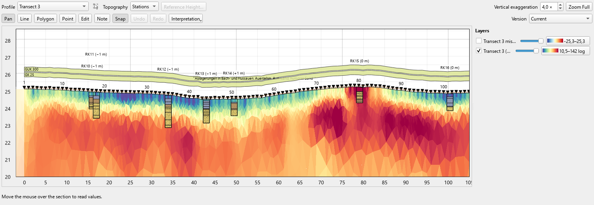

# The section panel

How to open a profile's section under the map, move around in it, read values and choose
how each model is drawn.

**Groundwork → Show Section Panel** opens the panel under the map. It shows one profile at a
time: its models, the ground line, the boreholes and points near the line, the geology strips,
crossing lines and your interpretation.

## Opening a profile

- Choose it in the **Profile** list, or
- click the button next to the list (**Pick Profile on Map**), then click the profile's line
  on the map.

Right-click the **Profile** list for **Profile Properties…** and **Delete Profile…** (see
[Projects and profiles](projects-and-profiles.md)).

## Moving around

- Drag to pan, turn the wheel to zoom; in the drawing tools, drag with the middle mouse button.
- **Zoom Full** shows the whole section.
- **Vertical exaggeration**: **Auto** fills the panel; type a number, for example 2 ×, to keep
  it.

## Section and map, linked

- Moving the mouse over the section moves a marker along the profile on the map.
- With **Pick Profile on Map** on, moving the mouse near the open profile on the map moves a red
  dashed guide line through the section.
- In the [3D view](3d-view.md#pointing-in-3d-shows-the-place-in-the-section), pointing at a
  curtain moves the section's cursor too.

## Reading values

The line under the section reads out where the mouse is, for example:

`s = 123.4 m · z = 61.2 m · depth = 3.8 m · X 432105.2 Y 5851234.9 · P1 model: 27.3 Ω·m`

- **s** is the distance along the profile, **z** the elevation, **depth** the depth below the
  ground line;
- every model under the mouse gives its value. It is the model's own cell value, however the
  model is drawn;
- "beyond stations" means the mouse is past the first or last electrode or geophone.

With **Pan**, click a borehole column to open it in the [borehole viewer](boreholes.md), or
click an interpretation piece for its attributes. Where both lie under the mouse, the details
show with an **Open in borehole viewer** link.

## The ground line: Topography

**Topography** chooses the surface the depth models hang from:

- **Stations**: the heights of the electrodes or geophones;
- **DEM**: the elevation model chosen in **Context Layers… → Band and DEM**;
- **Local** shows (and cannot be chosen) when the profile has no heights at all: the section is
  drawn in depth below its surface. **Reference Height…** next to it lifts it to real heights;
  see [Reference height](reference-height.md).

## The layer list

On the right, **Layers** lists the models on the profile, the top one drawn on top. For each:

- the tick shows or hides it;
- the slider sets its opacity;
- the colour button opens **Display…**.

Right-click a model for **Display…**, **[Dataset info…](dataset-info.md)** and **Remove from
profile…**. Removing takes the model off the profile; the file stays where it is.

## How a model is drawn

**Display…** holds everything about one model's look:

- **Colour scale**: **Colour ramp** (QGIS's ramps and your own), **Minimum** and **Maximum**,
  **Logarithmic**. **Auto** sets the 2nd to 98th percentile of the values.
- **Draw as**:
   - **Cells (as inverted)**;
   - **Smooth colour field**: blended over the cells, up to the ground line, never outside the
     model;
   - **Contours**, with labels on the lines;
   - **Smooth field + contours**.
- **Grid cell** of the smooth field: automatic, or your own size in metres.
- **Contours**: automatic steps (1-2-5 per decade on a logarithmic scale), your own
  **Spacing**, or your own **Major levels** and **Minor levels**.
- **Coverage**: **Fade where coverage is low**, **Below** a threshold you set; **Fade** or
  **Blank**. It needs a model file that carries coverage or sensitivity (BERT/pyGIMLi
  coverage, ResIPy sensitivity, Refrapy ray coverage).
- **Show**, for measured data (BERT/pyGIMLi data files, R2/ResIPy misfit): **Measured apparent
  resistivity**, **Calculated apparent resistivity (model response)** or **Misfit**, drawn as
  **Points (one per reading)**.

## Boreholes on the section

Boreholes within the **Search distance from the line** (**Context Layers…**) stand as columns
at their place along the profile. Right-click a column for **Hide in Section**: it is left out of
this profile's section and its plates, and stays in the borehole viewer. Right-click elsewhere
for **Show Hidden Boreholes** to get them back.

How the columns, their layer text and curves look is set in the
[borehole viewer](boreholes.md#styling); the section follows.

## What else is on the section

- **Points near the line**, **crossing lines**, **geology strips** and **ties with other
  profiles**: see [Geology, crossing lines and ties](context.md).
- **Field notes** along the top: see [Field notes](field-notes.md).
- **Interpretation** and its tools in the row above: see [Interpretation](interpretation.md).
- The **3D** button: see [Looking at one profile](3d-view.md#looking-at-one-profile).
