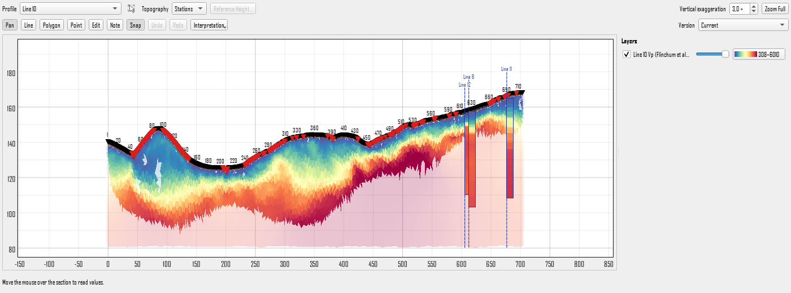

# Seismic refraction

How to bring P-wave velocity models from a refraction survey onto your profiles, next to the
resistivity, boreholes and geology.

## From Refrapy

1. In Refrainv, **Save results**. It writes `<line>_xzv.txt` and `<line>_topography.txt`.
2. **Groundwork → Add Data…** and choose the `_xzv.txt`. It is recognised as a Refrapy velocity
   model, and **Method** proposes **Seismic refraction**.
3. Under **Where the Line Runs**, choose the profile, or where a new one lies (see
   [Add data](add-data.md)).
4. **Add**.

The model comes in as P-wave velocity in m/s, with the ray coverage per cell. The shot and
geophone positions come from the `_topography.txt` next to the file and show as the profile's
geophones. Without that file the positions are unknown; the check result says so.

## From other programs

- **pyGIMLi** and Refrapy **`.vtk`** files: the velocity comes in, not the coverage.
- **Any text table** with distance (or easting and northing), depth or elevation and velocity:
  in **Add Data…** under **What the Columns Are**, choose **P-wave velocity (m/s)** as the value.
  A **Coverage** column, when the program writes one, takes its coverage or sensitivity per
  cell.

What each format must contain is in [Methods and formats](../formats/overview.md).

## Fade below the rays

In the layer's **Display…**, tick **Fade where coverage is low**: the part of the model no
ray, or few rays, reached fades out (or is blanked). For a Refrapy file the threshold starts at
Refrainv's own cut between resolved and unresolved cells; move it to see more or less. Cells no
ray reached count as the lowest coverage, so they fade too. See
[How a model is drawn](section-panel.md#how-a-model-is-drawn).

## The method in labels and plates

Each dataset knows its method. A velocity model is a *Seismic refraction Vp model*: the layer's
tooltip, the provenance line under a plate's section and the title block say so, and the colour
bar is titled *P-wave velocity*. A refraction profile has geophones, so the title block says
*Geophone spacing*. **New Profile…** offers **Seismic refraction** as the method.

## Resistivity and velocity on one line

Add both models to the same profile. The **Layers** list in the section panel shows them one
above the other; tick the one to see, or lower the opacity of the top one. On a
[plate](plates.md), add two section frames with the same profile, one with each model.

## Try it: the Calhoun demo

1. Unzip `groundwork_geophysics-demo-calhoun-<version>.zip` and open `calhoun_project.qgz`:
   four crossing refraction lines on a 1 m elevation model.
2. Open **Line 10** in the section panel. Lines 6, 11 and 12 are drawn where they cross it.
3. Open the layer's **Display…** and tick **Fade where coverage is low**.
4. Open the plate of Line 10 from QGIS's **Layout Manager**.
